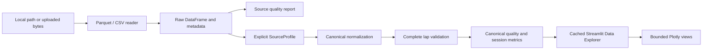

# Architecture v0.4 — Dataset Foundation

## Data flow

The analysis package has no Streamlit, FastF1, Keras or PyTorch imports. A consumer
can call `load_session(path, profile=...)` without starting a simulator or UI.

## Responsibilities

| Module | Responsibility |
|---|---|
| `motorsport/ingestion/parquet_importer.py` | Read path/bytes/stream with PyArrow; expose schema, row groups and embedded metadata |
| `motorsport/ingestion/csv_importer.py` | Read CSV, detect a restricted set of delimiters, support single-channel files |
| `motorsport/processing/schema.py` | Canonical fields, units and immutable source-profile configuration |
| `motorsport/processing/normalization.py` | Explicit mapping, declared unit conversions, invalid canonical values and provenance notes |
| `motorsport/processing/validation.py` | Missing/infinite/duplicate/constant/outlier statistics; timestamp ordering and gaps |
| `motorsport/processing/laps.py` | Conservative complete-lap boundary validation |
| `motorsport/analytics/session_metrics.py` | Metrics on the complete frame; extrema selection for chart views |
| `motorsport/pipeline.py` | Compose readers, normalization, validation and metrics into `TelemetrySession` |
| `pages/00_Data_Explorer.py` | Source selection, mappings, caches, controls and Plotly rendering |
| `streamlit_app.py` | Home and explicit navigation; optional legacy group |
| `scripts/audit_dataset.py` | Reproduce measured attachment audit and geometric investigation |
| `scripts/smoke_app.py` | Temporary HTTP health check; optional Chrome rendering/screenshots |

## Canonical representation

`TelemetrySession` provides `raw`, `data`, `metadata`, `raw_quality`, `quality`,
`laps` and `metrics`. The raw frame is retained; normalization initially shares
unchanged column storage and allocates converted channels. Callers should treat
both frames as read-only. Charts select a separate bounded view.

| Canonical field | Contract |
|---|---|
| `elapsed_s` | Seconds from first finite declared source timestamp; source order retained |
| `lap_id`, `lap_elapsed_s` | Assigned only to complete validated laps; outer fragments remain missing |
| `distance_m` | Optional source-provided distance in declared metres; never fabricated |
| `speed_kmh` | km/h; explicit m/s profile converts by 3.6 |
| `throttle_pct`, `brake_pct` | 0–100%; fraction profile converts by 100 |
| `rpm`, `gear` | Numeric engine speed and gear; broad plausibility flags include fractional gears |
| `steering`, `g_lat`, `g_lon` | Source scale retained unless a future adapter supplies verified units |
| `pos_x`, `pos_y` | Optional planar source coordinates; not a finish-line guarantee |

Additional source columns survive. Unvalidated source lap labels remain in `raw`
and are withheld from canonical labels. Manual “absent” mappings disable the target
in the canonical frame without changing the source.

The supplied profile maps `timestamp`, `rpms`, `throttle`, `brake`, `steer_angle`
and `pos_z` explicitly. The UI selects it automatically only after comparing a
local file's SHA-256 with the audited attachment. Other files default to canonical
names and explicit manual declarations. The Python API always takes a profile;
it does not guess provenance from filenames or numerical ranges.

## Quality policy

No row sorting, deduplication, forward filling or interpolation occurs. Canonical
unparseable/infinite values become missing; raw values remain available. Reports
distinguish missing cells from infinities, exact record duplicates from timestamp
duplicates, constants from unavailable columns, and broad physical limits from
exploratory 3×IQR flags. Mean signals are sample means, not time-weighted means.

Time gaps exceed `max(1 second, 10 × median positive step)`. Missing or backward
timestamps make session duration unavailable. Duplicate time values are reported
and preserved; they prevent strict lap validation. Acquisition rate uses the full
record span and is distinct from the reciprocal median positive interval.

## Lap policy

The validator requires finite strictly increasing time, consecutive nonnegative
integer completed-lap counters, progress in 0–1, and matching counter increments
and near-finish progress resets. A complete lap lies between two witnessed
boundaries. Durations must be 20–600 seconds by default, with no large time gaps.
These configurable plausibility bounds are not track-specific timing claims.
Leading/trailing fragments, partial recordings and laps with gaps are excluded.
Unreliable or missing lap channels return a reason rather than blocking sessions.

The attached file has constant zero lap channels. XY proximity is investigated
only in the audit and never promoted to a lap label. Integrated coordinate drift,
unknown finish position and incomplete fragments prevent certification. A future
geometric adapter would need validated world coordinates, a directional finish
gate, continuity/reset checks, coverage and track-specific duration validation.

## Caching and visualization

Local cache keys contain path, nanosecond modification time, size and mapping;
uploaded cache keys contain bytes, filename and mapping. Entries are bounded
(three local sessions, two uploaded sessions). No caches or uploads enter Git.
The current mapping is retained in session state for its matching file/profile.

Chart selection uses the union of per-channel bucket minima and maxima while
retaining first/last samples, capped at 5,000 rows. It reduces rendering cost
without reducing full-data calculations. A very large channel set may exceed one
bucket's budget, in which case final uniform thinning enforces the cap; the UI
limits selection to eight signals. This is visualization, not signal resampling
for ML. XY uses a coordinate trace with equal aspect ratio and warns about accuracy.

## Legacy integration and future models

Existing `motorsport_ui/analytics.py`, `motorsport_ui/svr.py` and all
`motorsport_prediction/` sources are preserved byte-for-byte relative to the
captured local baseline. They keep their historical schemas until migration.
Navigation hides historical pages behind an explicit legacy checkbox. Only the
selected page executes; local home/explorer never import simulator or DL packages.
Core requirements exclude FastF1, Keras and torch. Optional requirements and CI
training checks retain those capabilities.

Future adapters should supply `SourceProfile` mappings and provenance to this
pipeline. Future feature/model training must consume validated canonical data,
exclude invalid observations explicitly, and split by complete session/lap to
avoid leakage. v0.4 does not adapt or retrain historical models on this attachment.
