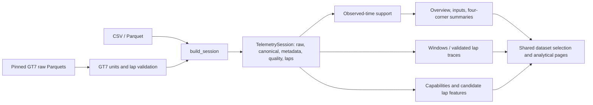

# Architecture v0.5

The v0.4 readers, canonical normalization, quality report and `TelemetrySession`
remain the foundation. v0.5 adds reusable analytics and one explicit source
adapter; simulator-specific assumptions stay outside the general algorithms.

## Modules and main functions

| Module | Function / responsibility |
|---|---|
| `motorsport/pipeline.py` | `load_session` keeps the file API; `build_session` composes raw frames from standard readers or an audited adapter; assigns canonical labels only to accepted laps |
| `ingestion/gt7_importer.py` | Hash-verify pinned lap files, convert packet units, preserve host and simulator time separately, cross-check lap targets, retain rejection reasons |
| `analytics/timebase.py` | `time_support`, `weighted_signal`, `fraction_time`, `chart_values`: observed-time statistics and render-only gap breaks |
| `analytics/overview.py` | `overview_metrics` and `gear_distribution`: separate sample and temporal statistics |
| `analytics/driver_inputs.py` | `braking_events`, `driver_metrics`: threshold occupancy, overlap, complete/partial events, entry speeds and source-scale steering activity |
| `analytics/channels.py` | Discover FL/FR/RL/RR families and expose known versus unknown signal units |
| `analytics/comparison.py` | `SessionWindow`, `select_window`, `compare_windows`, unit compatibility, `lap_trace` and guarded cumulative delta |
| `analytics/position.py` | `position_view`: finite coordinate inspection and bounded trajectory view |
| `analytics/readiness.py` | Evidence-based feature availability and explicitly retrospective `lap_features` |
| `motorsport_ui/telemetry.py` | Local catalog, bounded file cache, active source/upload registry, shared controls, charts and CSV exports |
| `pages/10_…15_…` | Dedicated overview, inputs, dynamics, tyre, comparison and position interfaces |
| `scripts/download_gt7.py` | Explicit pinned download, size/hash validation and preservation of existing differing files |
| `scripts/audit_v05.py` | Reproduce measured analytics/capability evidence for both local datasets |
| `scripts/smoke_app.py` | Temporary server, HTTP health and optional real browser rendering/screenshots |

The general analytics modules import NumPy/Pandas only. Plotly/Streamlit live in
the UI layer. No FastF1, PyTorch, Keras or heavyweight new dependency is required
for v0.5 analysis. Existing dependencies and F5 launch settings are reused.

## Observed-time method

For ordered elapsed times t and source values x, define forward intervals
Δtᵢ = tᵢ₊₁ − tᵢ. The default acquisition-gap threshold is
G = max(1 second, 10 × median positive Δt). Then:

- wᵢ = Δtᵢ for finite 0 < Δtᵢ ≤ G; otherwise wᵢ = 0.
- The terminal sample gets weight zero: no duration is invented after recording.
- A repeated timestamp has no dwell. The final observation at that timestamp
  governs the following positive interval.
- Any backward clock step disables all duration-weighted statistics for that
  frame rather than double-counting overlapping clock epochs. Missing time breaks
  support locally. Raw order and values remain unchanged.
- Observed duration = Σw. Recorded span is the ordered first-to-last finite endpoint
  difference, shown separately. Excluded-gap duration is displayed explicitly.
- For channel-specific valid observations V, temporal mean = Σ(wᵢxᵢ)/Σwᵢ over V;
  sample mean uses ordinary finite sample counts. The denominator/covered seconds
  are exported for every metric.
- Threshold usage = 100 × Σwᵢ·1(condition)/Σwᵢ over valid channel support. Pedal
  values outside 0–100 are excluded, not reinterpreted as zero. Overlap requires
  both valid pedals and separately configured thresholds.

This is a left-hold observation model, not reconstruction of unknown control
changes inside gaps. Median acquisition rate and samples/span rate differ on
irregular recordings and are not interchangeable.

## Braking and steering

An observed brake event is a contiguous sequence of supported intervals strictly
above the configured threshold, lasting at least the configured minimum. Zero-dwell
duplicate-time rows do not fragment a physical event. Large gaps and invalid samples
split sequences. A complete event needs a witnessed below-threshold interval before
onset and a below-threshold observation at release; recording/window-edge and
post-gap fragments remain partial. Its observed duration is Σw, not sample count
divided by a nominal rate. Entry speed is the observed onset speed, and reported
mean/max entry statistics use complete events only. This does not infer hydraulic
pressure or exact threshold-crossing sub-sample time.

Steering activity = Σ|xᵢ₊₁−xᵢ| / ΣΔt over supported intervals with both steering
endpoints finite. It is reported in source units per second, with no degrees,
driver-workload or physical-effort interpretation. Wheel/tyre channels remain
source reported; GT7's explicitly documented temperatures/suspension/positions
receive their published units, while unverified channels keep source units.

## Comparison contracts

Session windows retain declared start/end times and session IDs in Streamlit
session state, up to 20 saved selections. Relative time is t−selected_start, with
no stretching, interpolation or fabricated time delta. Only actual in-window
observations enter statistics; coverage may be shorter than arbitrary selection
bounds and remains visible. Clock resets reject temporal windows. Core canonical
units must match; unknown-scale channels across different source sessions require
an explicit shared unit reference and are otherwise excluded.

Validated lap traces use finite monotonic driven distance normalized to its
observed lap range for retrospective signal-shape comparison. This is labelled
approximate spatial alignment. Cumulative B−A time delta is a separate guarded
operation: two valid laps, an explicit verified shared track-distance reference,
finite strictly increasing distance/timer and gap-free support are required.
Interpolation is confined to common coverage, with no extrapolation. Neither
current real dataset supplies that shared reference, so no real lap delta is shown.

## Source timing, position and predictive data

GT7 host `wall_time` defines the session acquisition timeline. Its simulator
`current_lap_ms` and next-lap `last_lap_ms` define accepted lap time independently.
Host start/end differences need not equal simulator target durations. Counter-leading
stale timer packets stay in raw data and receive no canonical lap label. The source's
raw vertical pos_y is retained as `elevation_m`; canonical planar pos_y maps pos_z.
Metadata distinguishes source-reported world position from integrated/unverified
coordinates. No finish line or surveyed track geometry is inferred.

Content/schema fingerprints identify local sources; the GT7 bundle uses its pinned
revision. Feature exports include complete-lap IDs/targets and eligibility flags.
Full-lap candidate aggregates are explicitly retrospective, not progressive causal
features. See [ML_DL_READINESS_V05.md](ML_DL_READINESS_V05.md) for actual flags and
future grouped/chronological split requirements.

## UI and performance

Explicit navigation exposes six new pages and retains Data Explorer plus opt-in
legacy pages. A filename collision with a legacy comparison page was avoided by
naming the new module `14_Session_Comparison.py`; routes are explicit and unique.
The Data Explorer registers uploaded/manual-mapped sessions for other pages.
All analytical pages select local sources or those in-memory registrations.
Local cache keys include file signatures; the bounded GT7 bundle reader is selected
explicitly. Catalog discovery never initiates network requests.

Chart views use bucket extrema and a 5,000-row cap (3,500 for dense dynamics
scatter), while calculations preserve full resolution. Histograms aggregate full
data before rendering. Render-only NaN breaks avoid drawing continuous signals
through acquisition gaps. Position plots show finite coordinates, quality counts,
speed/pedal coloring, hover details and an exact selected-source-sample marker;
heading is withheld because neither adapter establishes a validated convention.
CSV downloads expose derived metrics, event tables and candidate lap features.

No training migration or legacy architecture rewrite is included. Historical
analytics/SVR/prediction source files remain identical to the committed v0.4 base.
