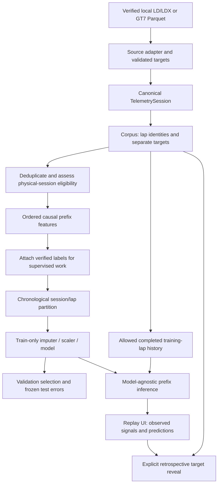

# Architecture and learning guide v0.6

The v0.5 ingestion/normalization/analytics layers remain intact. Two pure source
adapters feed `TelemetrySession`; a new `motorsport.ml` layer consumes only
independently checked lap spans. Streamlit calls that layer through a shared
corpus selector. Historical SVR/Keras/FastF1 implementations remain unchanged.



## Key Python functions

| Function / object | What it does; why the boundary matters |
|---|---|
| `ingestion.motec.read_ld(path, selected)` | Reads only bounded numeric structures; follows linked offsets, applies declared physical scaling, returns header and typed channels; no third-party code or pickle |
| `acgym_importer.load_acgym_sessions(...)` | Hash-checks cached sources; returns canonical sessions plus quarantined recording reasons; never downloads |
| `acgym_importer.validate_laps(frame, beacons, hz)` | Cross-checks counter, source clocks, witnessed finish target, invalidation and line coverage; labels only accepted spans |
| `ml.dataset.from_sessions(sessions, name)` | Converts verified spans into `ReplayLap` objects with reduced safe frames and a separate target/provenance table; removes duplicate capture and lap signatures |
| `ml.dataset.independent_subset(corpus)` | Excludes unresolved physical-identity units while retaining exclusion evidence |
| `ml.dataset.eligibility(corpus)` | Measures actual verified-lap/session counts, domain, independence and key coverage; never trusts an arbitrary `session_count` assertion |
| `ml.features.causal_prefix(source, checkpoint)` | Stops at first unavailable/future packet and verifies only observed support; later resets cannot add future packets |
| `ml.features.prefix_features(...)` | Creates the numeric causal allowlist and quality indicators using only that prefix |
| `ml.features.snapshots(corpus, checkpoints)` | Produces prefix rows, then separately joins audited targets by lap UID; returns rejected checkpoint reasons |
| `ml.features.retrospective_features(corpus)` | Whole-lap descriptive statistics; deliberately different column names and no training path |
| `ml.baselines.reference_history(corpus, allowed_ids)` | Creates completed references exclusively from explicitly permitted training lap IDs |
| `ml.baselines.baseline_predictions(source, history)` | Filters comparable, earlier completed laps; returns previous/median predictions or unavailable |
| `ml.training.chronological_split(...)` | Assigns complete physical sessions chronologically; experimental single-session mode assigns complete laps |
| `ml.training.train(...)` | Enforces eligibility and numeric feature allowlist, fits three pipelines on train rows, selects on validation and retains frozen independent results |
| `ml.evaluation.summarize(predictions)` | Metrics by checkpoint, lap, session and matched baseline population; individual errors retained |
| `ml.inference.predict(...)` | Accepts replay source/checkpoint, generic estimator/feature order, domain and permitted prior history; produces no actual target |
| `ml.inference.retrospective_error(prediction, target)` | Explicit evaluation-only target join, called after predictive computation |
| `ml.artifacts.LocalArtifactStore` | Locally produced model+preprocessing serialization with hash/signature verification before loading |
| `motorsport_ui.ml.select_corpus(page)` | Local cache invalidated by source/manifest file signatures; no startup network or training |

Example without Streamlit:

```python
from motorsport.ingestion.acgym_importer import load_acgym_sessions
from motorsport.ml.dataset import from_sessions, independent_subset
from motorsport.ml.training import train
from motorsport.ml.inference import predict

sessions, quarantined = load_acgym_sessions()
corpus = independent_subset(from_sessions(sessions, 'Human Monza / Dallara'))
bundle = train(corpus)  # explicit computation; requires eligibility
lap = corpus.laps[-1]
result = predict(lap, 30, bundle.models[bundle.selected_model],
                 bundle.feature_names, bundle.history, model_domain=bundle.domain)
print(result.predicted_final_s)  # no final target passed to inference
```

## UI lifecycle and performance

`pages/20_Machine_Learning.py` shows audited counts, eligibility, feature availability,
provenance, explicit training, all model/baseline results, scatter/error distribution,
per-group errors, importance and exports. `st.session_state['ml_bundles']` keys each
bundle by corpus identity; reruns and sidebar navigation preserve the trained bundle.
The displayed bundle feature list remains visible if the user changes the pending
feature selection without retraining.

`pages/21_Progressive_Prediction.py` reuses the selected corpus and bundle, defaults
to a held-out lap, advances an elapsed-time slider and plots **only observed** signals
and earlier predictions. Without a trained bundle it offers frozen training-history
baselines. Empty/no-reference data stays explicitly unavailable. Targets and errors
remain hidden until the user requests retrospective evaluation. Replaying a training
lap carries a warning and is never labelled an independent result.

Data/snapshots use bounded Streamlit caches; model fitting occurs only on button
click. Source import selects 14 relevant numeric channels rather than loading all
169 LD signals into every ML object. Rendering is limited to roughly 3,000 prefix
samples; calculations use all source observations. No new heavyweight runtime
dependency is introduced: sklearn and its small joblib dependency were already
installed. Neither local page imports FastF1/Keras/Torch nor needs internet.

The F5 configuration is unchanged. Routes `/ml` and `/replay` are added to the
existing explicit navigation; existing source selection and analytical routes
remain compatible. The homepage still starts without reading the new corpus.

## Scope for v0.7

The estimator interface can accept a Keras wrapper later without changing replay's
target boundary. It currently supports fixed tabular prefix summaries, not sequence
tensors, calibrated uncertainty, live capture, or certified common-distance progress.
Session/driver independence, export timing and a larger frozen test set need further
work before a deep network's evaluation could support stronger claims.
