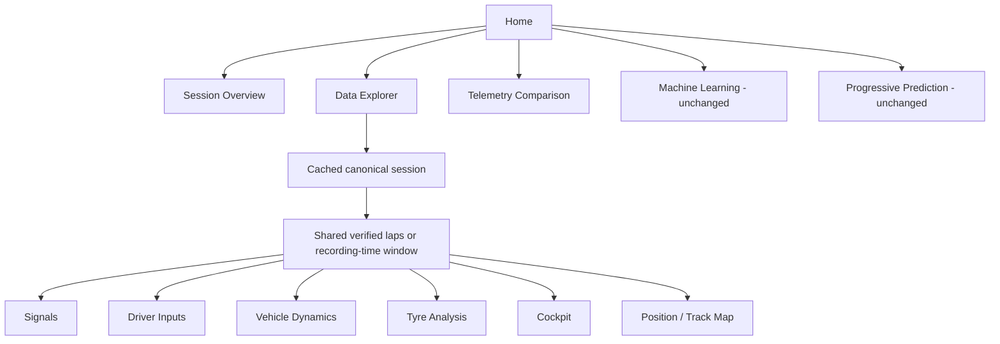

# Architecture v0.6.1

The release refactors rendering and selection. `motorsport.pipeline`, source lap
validation, time-weighted analytics, retrospective feature extraction and all
`motorsport.ml` contracts remain unchanged from local v0.6 commit `49639f4`.

## Navigation and rendering

`streamlit_app.py` registers only principal pages and optional historical FastF1
tools. The four historical analytical page scripts remain small compatibility
wrappers; navigation renders their functions only inside Data Explorer.
`motorsport_ui.inputs`, `dynamics`, `tyres`, `position` and `cockpit` accept an
already selected canonical session/frame. They never choose/reload a source.
Driver-input, dynamics and tyre algorithms retain full-resolution inputs.

`pages/00_Data_Explorer.py` mounts exactly one section using a secondary radio
control. Hidden analytical tabs no longer create charts or run analysis eagerly.
Source metadata, raw preview and channel quality remain in a collapsible panel.
CSV/Parquet upload, explicit column/unit mapping and metric exports are retained.

## Source lifecycle and cache

`motorsport_ui.telemetry` keeps the existing `load_local` cache and per-browser
`telemetry_registry`. File mtimes/sizes invalidate cached entries. Source registrations
survive section reruns; the source loader is tested to execute once across six
section switches. GT7 reuses its existing hash-checked world-coordinate adapter.

`source_catalog(include_acgym=True)` adds local independent ACGym recordings.
Each `acgym:<manifest path>` key identifies one recording, with manifest, LD and LDX
signatures. The loader verifies source/timing evidence hashes and calls the existing
audited adapter. `motorsport_ui.acgym.enrich_recording` then reads a bounded set of
tyre, pressure, load and suspension channels for UI use. Additional channels must
match declared units, export frequency and row count; there is no resampling.
Canonical aliases coexist with original names and declared units.

The ML catalog uses the default `include_acgym=False`, including when recordings
were previously registered in the Explorer. Its separate `acgym` corpus key, dedup,
independence exclusions, cached snapshots, training bundles and evaluation are
unchanged. UI enrichment never enters the existing corpus loader.

`motorsport_ui.explorer_source` caches uploads/mappings. Upload keys hash bytes and
filename; a submitted mapping replaces the registry session. Dataset loading has
no automatic download or training path. Uploaded browser data remains in memory.

## Selection contract

`motorsport_ui.selection.lap_labels` obtains IDs and measured `duration_s` only
from `session.laps.laps` when validation is available. It never infers timing from
coordinates or raw source counters. Labels round measured times to milliseconds.

Durable state and temporary widget state are separate:

| Durable key | Purpose |
|---|---|
| `telemetry_active_key` | Source shared by Overview and Explorer |
| `telemetry_registry` | Current mapped/local/upload session objects |
| `explorer_identity` | Hash of session, mapping, source signature and verified lap table |
| `explorer_selected_laps` | Selected verified IDs; unchanged across analytical sections |
| `explorer_time_range` | Recording-time fallback; unchanged across sections |
| `explorer_section` | Active secondary analytical section |

Temporary `_explorer_laps`, `_explorer_range` and source widget values synchronize
through callbacks. This handles Streamlit widget cleanup when a control/page
disappears. `reconcile_selection` resets incompatible values on dataset, revision
or mapping changes, including sources with coincidentally identical lap numbers.
Cockpit sub-lap and marker controls are also invalidated where necessary.

`selected_frame` retains source row indices and source order, annotating selected
lap frames with `_ui_lap`. Signal charts split by that label and use measured
`lap_elapsed_s`. They never align independent laps on absolute recording timestamps.
Without verified laps, the shared selector uses finite nondecreasing `elapsed_s`.
Unknown timestamps inside the selected endpoints remain present, preserving gaps.
If time itself is unavailable, sections explain the limitation and inspect source
samples; Cockpit explicitly falls back to recorded sample order.

## Figures and scrolling

Detailed line charts use `go.Scatter` SVG with the existing extrema-based bounded
downsampling (5,000 rows shared across selected lap traces). Dynamics scatter views
use explicitly bounded SVG (3,500 rows). Chart heights are explicit; no custom
scrolling containers, overflow overrides or global CSS patches are introduced.
Stable chart keys and `uirevision` keep interaction identity within mounted sections.

The archived v0.6 explorer was tested in real Chrome with eight selected channels,
tab switches and multiple scroll positions. It rendered two figures/six GL canvases;
no context-loss event or disappearance was observed. GPU lifecycle dependence was
investigated, not proven as the original cause. New SVG rendering and lazy mounting
are validated mitigation; device-specific intermittent failures remain unconfirmed.
See [the actual investigation](UI_TEST_REPORT_V061.md).

## Connected trajectories

`motorsport.analytics.position.position_segments` is pure. It checks adjacency on
full-resolution data before any display simplification. It preserves the source
coordinate system and breaks at:

- Missing/nonfinite X/Y or time; nonpositive time steps, including repeated clocks.
- Time gaps exceeding `max(1 second, 10 * median positive step)`, matching existing
  temporal-support policy.
- Different or unknown validated lap IDs, or removed nonconsecutive source rows.
- Spatial steps over 20 times the median positive valid source step. This conservative
  heuristic is scale independent; it does not certify physical geometry.

Connected runs reserve both endpoints, then share a 6,000-vertex display budget.
Simplification only joins vertices within one already validated run. If fragment
count exceeds the endpoint budget, the longest runs are retained in original order
and the number omitted is shown. No analytical calculation uses this simplified view.

`trajectory_figure` groups segments into at most 32 continuous color bands rather
than one heavyweight trace per edge. Color is the actual measurement at each rendered
segment's starting sample. The full finite source range, including outliers, defines
the colorbar; quantization is disclosed. Known gear/identifier/boolean signals use
distinct categorical colors where the number of values is bounded. Constant
continuous signals get a nonzero colorbar range; missing values render grey.
Every finite real numeric canonical/original column is eligible. Unknown units stay
labelled `source unit`; complex/text and entirely nonfinite columns are excluded.

The marker shows a real source sample. Original integrated geometry and GT7 simulator
world geometry retain warnings. ACGym's `Position` is rank and `Car Pos Norm` is
dimensionless progress; neither is transformed into world coordinates.

## Cockpit and comparison

Cockpit receives the shared subset, chooses one of its selected verified laps when
needed, and chooses the nearest finite-time actual packet (`sample_at`). Ties use
the earlier source row. Speed/RPM/gear/pedals use canonical units; tyre temperatures
require an explicit temperature unit. Missing channels are hidden or shown N/D.
Responsive cards use a local wrapping CSS grid without modifying Streamlit layout.
Optional context traces reuse the same selected frame. This is recorded replay.

Comparison prioritizes verified laps whenever both sessions supply them. Track identity
and compatible-unit guards remain in place. Timing uses relative lap elapsed seconds;
the existing distance-alignment and cumulative-delta analytics APIs are untouched.
Arbitrary windows retain their original saved-window path and explicit labels.
`comparison_figure` assigns deterministic colors from source/lap/window identities,
resolves collisions in stable order and enables legend entries only on the first
channel row. One shared legend serves every titled/unit-labelled channel subplot.

## Preserved contracts

No changes to `motorsport/ml`, `motorsport_prediction`, `motorsport_ui/ml.py`, the
two ML/replay pages, source validation, historical FastF1/SVR/Keras code or `.vscode`.
The regression suite covers causal prefixes, future/held-out-label invariance,
train-only preprocessing, targets, artifacts and explicit training/replay. The
additional frozen-prediction check is described in the release/testing reports.
