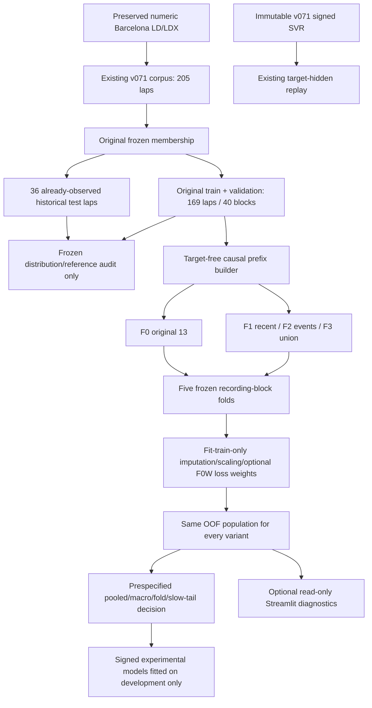

# Architecture v0.7.2

The production v0.7.1 Barcelona loader, three baseline pipelines, feature builder,
split, signed store, inference and original evidence remain unchanged. New
diagnosis and feature experiments live in separate modules and artifacts. The
original 205 usable laps stay available in the primary interface.

## Module boundaries

| Module | Responsibility |
|---|---|
| `motorsport/ml/diagnosis_v072.py` | Unique-lap distributions, immutable-reference calibration/sensitivity, development-only feature information, source progress inspection and preservation hashes |
| `motorsport/ml/temporal_features_v072.py` | One target-free feature API shared by training and experimental replay; timestamp-clipped trailing windows, observed events and path-distance proxy |
| `motorsport/ml/development_v072.py` | Historical exclusion before features; seeded group folds, training-only pipelines/weights, OOF metrics/selection and isolated signed research artifacts |
| `motorsport_ui/ml_diagnostics.py` | Read verified JSON/CSV only after explicit opt-in; display development comparisons/examples with production reference identity |
| `scripts/run_barcelona_v072.py` | Explicit offline audit and experiment, frozen rerun/research-artifact reconstruction; no data download |
| `scripts/report_barcelona_v072.py` | Static PNG/SVG and reports from tables; no prediction or model fitting |
| `scripts/verify_baselines_v072.py` | Original Monza/GT7 numeric regressions; Barcelona stored-reference and validation-only inference checks, no new historical-test prediction |

Predictive rows are built before the label join. F0 calls the existing feature
implementation unchanged. New descriptors use real observed timestamps and left
support, without final duration/distance, full-lap summaries, target values,
participant IDs, source IDs or future samples. Prefix validation rejects bad
boundaries and clock gaps; optional channel imputation fits only the fold's
training population. The original source importer is not modified.

`Car Pos Norm` is inspected for diagnostics but not admitted as a new feature:
the exact ACTI export mapping/resampling semantics remain unestablished. The
independent ground-speed integral is explicitly a path-distance proxy in metres,
without normalization by any eventual distance or invented coordinates.

## Artifacts and reproducibility

Reference: existing `artifacts/barcelona_v071/models`. Research:
`artifacts/barcelona_v072/models/development-v072-<development_identity>.joblib`.
The reused local SHA/HMAC store verifies provenance before deserialization. Research
metadata binds domain, original corpus fingerprint, development-only identity,
feature/version/units, protocol hash and deterministic fold identity. The full
corpus fingerprint is provenance, never a numeric model input or selection score.

Frozen OOF CSVs and selection/fold JSONs are hash-verified before reuse. A missing
research artifact can be rebuilt on all development laps without rescoring the
folds or historical test. Existing incompatible/untrusted artifacts fail verification
rather than being silently signed again. V072 JSON/CSV line endings are fixed to
LF in Git so Windows checkout cannot change byte identities.

`predict_experimental` checks domain/version/feature contract and accepts only
development source IDs. It uses exactly `feature_row` from training and has no
target argument. Its returned mode states that the final research model was
fitted on development data; this is not an independent evaluation. The UI shows
cached OOF histories rather than these in-sample research predictions. Since no
variant qualifies, the production replay engine is not replaced.

## UI and evaluation semantics

The existing baseline page renders its original three charts by default. The new
diagnostic expander's checkbox is false initially; only explicit opt-in reads
development tables and renders five additional figures. Source/model controls,
raw-data analytical pages, shared hover/cursor code and F5 entrypoint are preserved.
Reference replay still constructs chart payloads before retrospective target access.

Original validation and historical-test scores retain their original populations.
Development OOF scores use retrained **reference configurations**, not predictions
from the immutable production fit. The five outer folds have overlapping training
sets, and exploratory diagnostics/design reuse development data; these are model
development comparisons, not unbiased new final-test estimates. Recording blocks
also do not establish physical-session or participant independence.

The only UI integration edits identify v0.7.2, identify the operational reference
and add optional diagnostics. No new dependency, acquisition path, live recorder,
Keras model or production numerical change is introduced.
