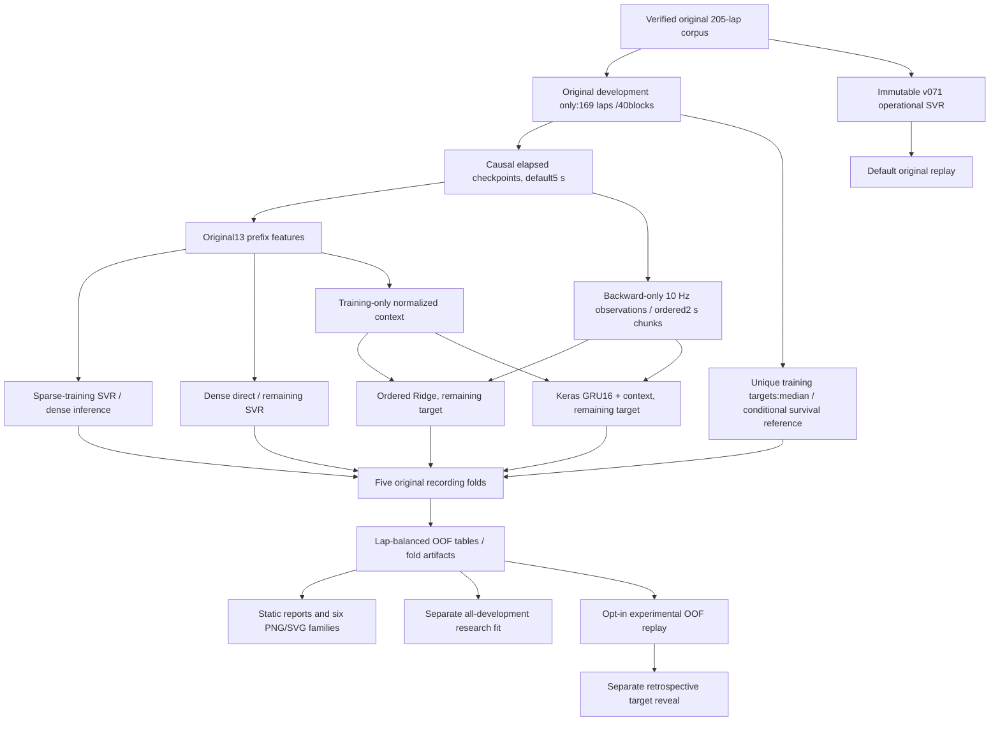

# Architecture v0.8

The operational numerical pipeline, signed v071 reference, all 205 validated laps,
v071/v072 evidence and shared hover component remain preserved. New work is
isolated under versioned modules and `artifacts/barcelona_v080`.

`progression_v080.py` schedules from arriving telemetry without receiving a target.
`sequences_v080.py` builds whole-prefix chronological chunks, train-only transforms,
explicit masks and a lazy Keras model factory. `dense_experiment_v080.py` owns the
bounded candidates, frozen memberships, inner early stopping, output inverse,
constraints and isolated signed artifacts. `evaluation_v080.py` alone joins the
retrospective scoring concepts: lap-balanced errors, pace/stage and last-prefix
summaries. `scripts/prepare_barcelona_v080.py` audits full development source
progress and freezes preservation/fold evidence before fitting.

Historical test is filtered before representation generation, normalization,
early stopping and scoring. The full corpus hash is artifact provenance only.
GRU uses four outer-training blocks for validation; outer scores never select
epochs. Classical models fit all outer-training blocks; this difference is
reported as a limit on causal architecture comparisons. All-development research
fit is distinct from the fold artifacts used for UI OOF replay.

Chunks support up to600 observed seconds independently of eventual completed lap
length. Every candidate sees exactly the same nominal and actual cutoff. Source
clock defects cannot be repaired by future observations. `Car Pos Norm` remains
diagnostic only; no live percent or final-distance normalization is introduced.

The native Keras file is verified against the digest stored inside an authenticated
classical bundle before safe-mode deserialization. Keys and models remain local
and ignored by Git. Metadata binds domain, corpus/dev identity, feature order,
protocol, folds and allowed development IDs. Unknown/incompatible artifacts are
unavailable, never silently retrained or signed. Fixed evidence is verified on
rerun; reconstruction requires an explicit offline command.

`motorsport_ui/progressive_v080.py` loads cached fold artifacts only after opt-in.
Only selecting GRU imports Keras/Torch. Predictive charts receive observed signals
and target-free predictions only; target/error tables are read after the explicit
reveal checkbox. Aggregate OOF metrics are labelled development. Missing optional
dependencies/artifacts leave the operational reference usable. Default page visits
neither train nor acquire data. Windows F5 configuration stays byte-identical.
