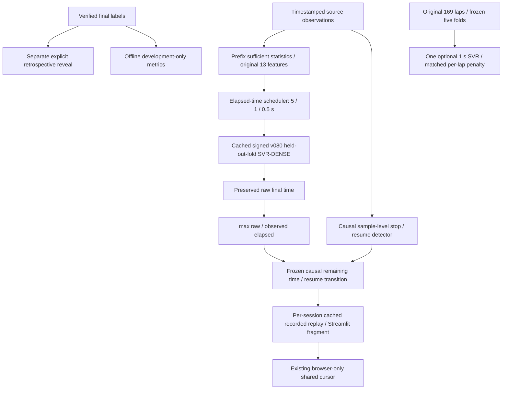

# Architecture v0.8.1

The existing v071 operational and v080 SVR/GRU paths are unchanged. New code is isolated in `replay_v081.py`, `cadence_v081.py` and `progressive_v081.py`; reports/artifacts use V081 names.

`PrefixIndex` precomputes causal cumulative interval statistics and validates source-clock continuity. Predictions retain nominal and observed seconds. `ReplayEngine` advances a detector once per arriving sample, independent of display cadence. Stop onset and resume model queries are cached at actual sample timestamps, giving identical corrections at shared cutoffs. Rewind initializes isolated state when needed. No wall clock or target enters that engine.

The UI authenticates and caches existing fold models, validates full corpus identity once per ordinary rerun and retains a mutable engine in session state, never shared across user sessions. Fragment timer reruns avoid reloading datasets, recalculating full corpus identity or loading models per checkpoint. Charts contain only observed prefix signals and selected predictions. Targets are read only by the explicit reveal block and offline scorer. Changing replay context resets reveal.

One-second training is an explicitly invoked offline function with training-only preprocessing. It stores signed fold bundles separately and never replaces Model A or the operational reference. Separate fresh-process workers measure each inference cadence. Frozen evidence has SHA-256 bindings; the baseline inventory includes raw recordings, previous reports, signed model bytes and F5 files. Existing signing keys remain private local files.
