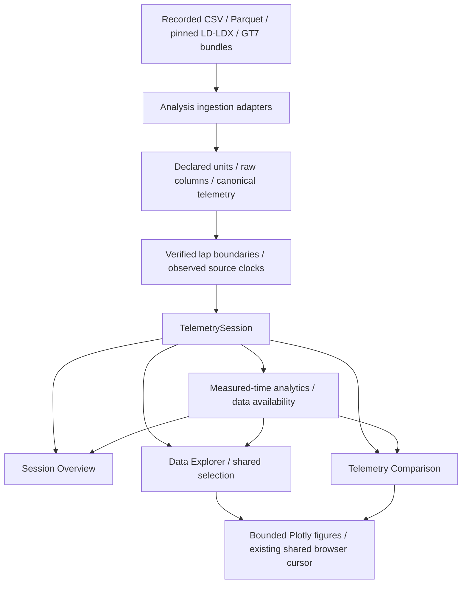

# Architecture v0.8.2

- `motorsport/ingestion`: original CSV, Parquet, MoTeC/ACGym and GT7 readers.
  New `barcelona.py` owns only domain/path/hash checks and the inclusive verified
  timing configuration. It replaces the former accidental import from ML.
- `motorsport/processing`: unchanged normalization, unit contracts, source
  validation and lap assignment.
- `motorsport/analytics`: unchanged measured-time, driver-input, position,
  comparison and session calculations. `readiness.py` keeps analysis capabilities
  and verified lap timing; prediction eligibility gates/feature builders are gone.
- `motorsport_ui`: existing source cache/registry, durable lap/window selection,
  telemetry renderers and shared hover/cursor. No prediction state/cache remains.
- `streamlit_app.py`: Home and three analysis routes, plus the existing opt-in
  Formula 1 analysis pages. Model pages and training controls are absent.
- `scripts`: analysis acquisition/audit and verification commands only. The
  verification-only `analysis_guard.py` prevents prediction imports and model
  artifact access during tests; it is not part of normal application startup.

Core dependencies are NumPy, Pandas, PyArrow, Plotly and Streamlit; pytest supports
verification. Optional FastF1 remains solely for retained Formula 1 analysis.
Keras, Torch, scikit-learn, joblib and the sequence requirements are removed from
the active dependency declarations. Installed historical packages and ignored
artifacts remain untouched.

The original ML implementation is recoverable at the documented Git commit in a
separate worktree. Raw datasets and historical model binaries stay at their
existing ignored paths. Current code does not load them.

Verification compares pre-cleanup canonical signal hashes and overview values
on 73 sources, plus every original validated Barcelona lap trajectory. Browser
checks retain prior source/geometry/hover/selection assertions and test retired
routes with model imports/file access blocked.
