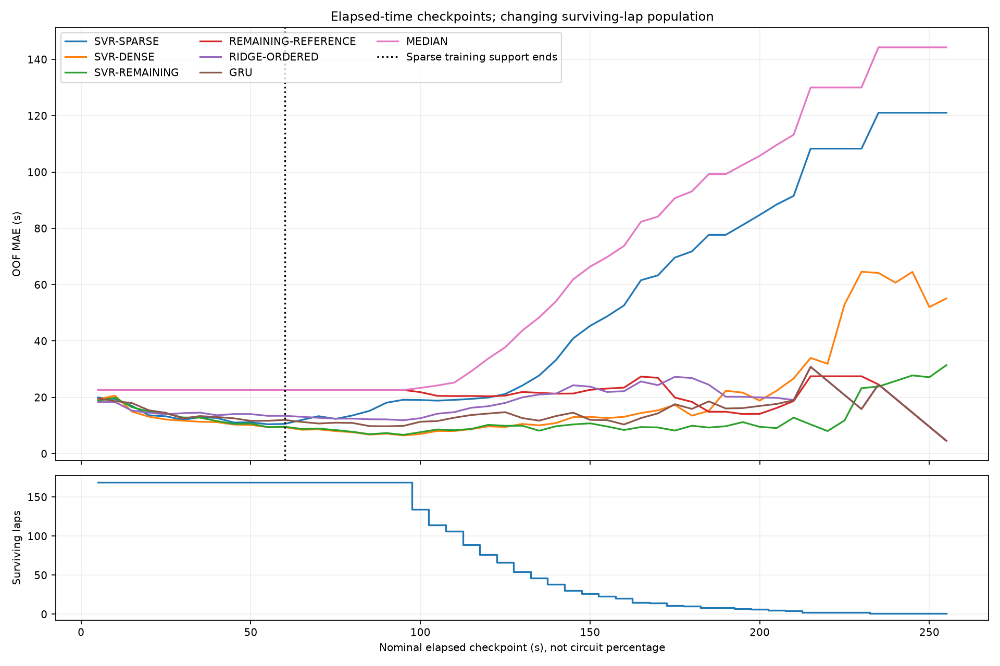

# Checkpoint strategy v0.8

All results below are exploratory **development OOF**, not a fresh independent test. All 169 development laps / 40 recording blocks are retained; 36 already-inspected historical test laps are excluded before representations. Source block independence is imperfect and folds overlap in fitting. Operational SVR v0.7.1 and its historical evidence remain unchanged.

Use the **elapsed-time fallback**, default every 5 s, configurable in replay. Compatibility remains 10/20/30/45/60 s. There are 4134 actual correlated observations, 19–51 per lap. A checkpoint uses the last source sample at or before its nominal second, with <=100 ms freshness. Preserve this exact observed timestamp. No time fraction, eventual duration, final distance, centered interpolation or invented circuit percentage is used.

The source scan stops on the first missing/reset clock or gap >200 ms. No later observation repairs that prefix. Schedule emission depends on observations arriving; source-tail mutation cannot change an already emitted checkpoint. Near completion the last scheduled point is less than5 s from the end on this valid population; it is identified retrospectively for scoring only.

## Progress investigation and decision

The [author project](https://assetto-corsa-gym.github.io/) identifies ACTI as its human-data exporter. The [primary paper](https://proceedings.neurips.cc/paper_files/paper/2024/file/b91ea2ba1b6521940e204b7b81d5ef47-Paper-Datasets_and_Benchmarks_Track.pdf), Appendix F.4, describes a simulator normalized track-position input. This documents the simulator interface; it does not certify an exact mapping to `Car Pos Norm` in these human LD exports. The author's [conversion code](https://github.com/dasGringuen/assetto_corsa_gym/blob/main/motec_to_pickle.py) and [configuration](https://github.com/dasGringuen/assetto_corsa_gym/blob/main/motec_to_pickle_config.yml) did not establish the missing exact mapping/interpolation/latency contract during this investigation.

Full development-only inspection: range 0.0–1.0, 169 laps with negative steps, 169 with a large wrap. Every lap includes a terminal position wrap while the lap timer/counter still belongs to the outgoing lap. For example the first AB lap crosses 0.999933 at 174.91 s to0.000167 at 174.93 s. This is compatible with a finish-line position channel, but numeric compatibility is not independent semantic verification. Additional local reversals can reflect reverse motion or export effects; not every negative step is a fault. All laps are retained.

Source declared units are blank, export rates50/100 Hz; native sensor cadence and interpolation kernels are not established. Values are position-like and plausibly independent of eventual target, but this inference is insufficient to enable percentage thresholds. No production5% scheduler is exposed. This avoids pretending that eventual time fractions are track progress. [Per-lap source evidence](PROGRESS_SOURCE_AUDIT_V080.csv) records ranges, endpoints, discontinuities and export cadence.

## Deterministic remaining-time reference

For unique permitted training targets T and observed elapsed t, return median(T given T>t), equivalently t+median(T-t given T>t). In-lap survival is available at prediction time. If no training lap survives, remaining is0 and support 0 is reported. This is a **survival-conditioned elapsed-time population baseline**, not a physical position or remaining-distance model. Long late laps can have very small support and severe selection bias. Held-out targets never update the profile. MEDIAN remains the unconditional training-target baseline.

Compare models at the same observation; do not interpret lower MAE on the shrinking late population as a within-lap causal gain. Shared 5–60 s, original sparse checkpoints, early/middle/late, last-scheduled and retrospective final10 s reports are separate. The retrospective bands never enter inference/UI before reveal.

See [comparison](ML_COMPARISON_V080.md), [checkpoints](CHECKPOINT_STRATEGY_V080.md), [dense SVR](SVR_DENSE_EXPERIMENT_V080.md), [sequences](SEQUENCE_MODEL_EXPERIMENTS_V080.md), [protocol](ML_PROTOCOL_V080.json), [results/hashes](ML_RESULTS_V080.json) and [architecture](ARCHITECTURE_V080.md).
