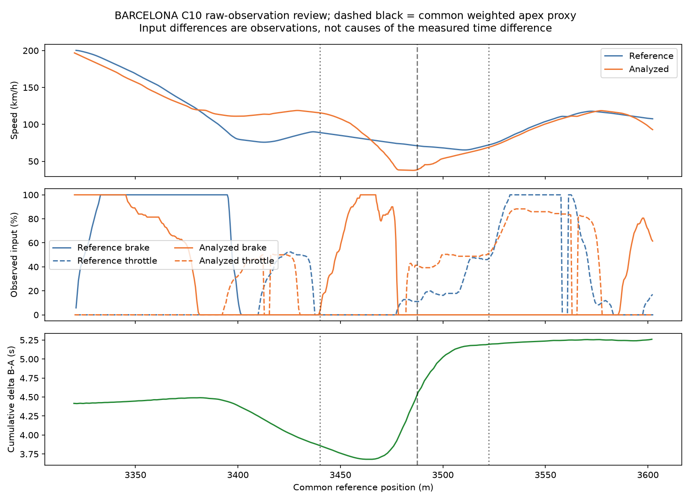

# Deterministic KPI definitions v0.9.0

All measurements are retrospective facts or explicitly named operational proxies.
They are not causal explanations or coaching. The engine returns 35
focused per-corner metrics with definition, original/compatible unit, A/B values,
difference, actual temporal measurement windows, source signals and quality/reason.
The reference-corner spatial context is stored separately because approach and
exit windows extend beyond the geometric corner.

## Event and measurement contract

Brake entry is ≥5% sustained for
0.15 s; release is ≤
2% for 0.1 s.
Use actual elapsed timestamps, never packet counts. Missing samples or clock gaps
>0.2 s censor events. Detect full-lap events first; consider observed onsets within
120 m before reference corner entry through its apex.
All events are retained; multiple/censored events do not receive an invented
primary phase. An event released >30 m
before geometric entry has **uncertain corner association**: observed phase values
are kept, but a claimed corner-braking difference is withheld. This quality rule
was added after raw-overlay review found an earlier completed event in an approach
window; it avoids presenting unrelated phases as a valid braking comparison.

Throttle application is ≥20% for
0.3 s, searched from common apex or observed
minimum-speed region through an exit extension of 80 m.
Already sustained application at apex gives an explicitly operational zero delay;
no clear application gives null with explanation. Full-lap temporal summaries stay
available even when spatial geometry is unsupported.

Means use observed-time left-hold weights with ≥99% support; terminal samples have
no invented dwell. Landmark values interpolate only fresh, finite source brackets
≤0.2 s apart. Peaks/minima are observed values. Wrapped corners combine two pieces
of the selected lap for section accounting, but do not infer continuous event
chronology, rates or signal interpolation across their artificial seam.

Steering remains in the declared source convention (deg/rad); incompatible or
unverified units cannot produce a numerical difference. G-based acceleration
requires explicit g/G units. GT7 derived steering calibration and sway/surge units
remain unverified, so their physical KPIs are unavailable. Brake input is not
actual deceleration; reduced steering is not automatically better. The operational
trail-braking proxy is brake-input overlap with the geometric entry-to-apex
window, not a tyre-force/weight-transfer estimate.

Common circuit **position** differences use signed shortest circular displacement;
other compatible scalars use analyzed minus reference. Distances during braking
use that lap's actual driven XY distance, not normalized reference distance.

| name | unit | definition | signals |
| --- | --- | --- | --- |
| braking_event_count | count | Confirmed events with observed onset in the approach-to-apex window | brake_pct |
| brake_onset_position_m | m | First observed sample reaching configured brake-on threshold of the unique confirmed approach event, on common reference | brake_pct, pos_x, pos_y |
| brake_release_position_m | m | First observed sample below the configured brake-off threshold of a sustained release | brake_pct, pos_x, pos_y |
| braking_distance_m | m | Observed driven XY distance during the unique braking event | brake_pct, pos_x, pos_y |
| braking_duration_s | s | Observed onset-to-release time of the unique braking event | brake_pct, lap_elapsed_s |
| maximum_brake_pct | % | Maximum source brake input in the unique braking event | brake_pct |
| mean_brake_pct | % | Left-hold observed-time mean input during the unique braking event | brake_pct |
| speed_at_brake_onset_kmh | km/h | Source speed at the observed event onset sample | brake_pct, speed_kmh |
| speed_at_brake_release_kmh | km/h | Source speed at the observed release sample | brake_pct, speed_kmh |
| brake_onset_to_apex_m | m | Forward common-reference distance from brake onset to reference weighted apex proxy | brake_pct, pos_x, pos_y |
| trail_braking_proxy_duration_s | s | Observed brake>=on-threshold overlap from geometric corner entry to common apex; input proxy, not tyre-force inference | brake_pct |
| speed_at_apex_kmh | km/h | Speed interpolated from fresh observed samples at the common reference apex proxy | speed_kmh |
| minimum_corner_speed_kmh | km/h | Minimum observed speed within reference corner time boundaries | speed_kmh |
| minimum_speed_position_m | m | Common reference projection of that minimum-speed observation | speed_kmh, pos_x, pos_y |
| entry_speed_kmh | km/h | Observed/bracketed speed at reference corner entry | speed_kmh |
| exit_speed_kmh | km/h | Observed/bracketed speed at reference corner exit | speed_kmh |
| mean_corner_speed_kmh | km/h | Left-hold observed-time mean speed within the reference corner | speed_kmh |
| minimum_trajectory_radius_m | m | Inverse maximum absolute curvature of this lap smoothed metric trajectory in the reference corner | pos_x, pos_y |
| maximum_trajectory_curvature_1_m | 1/m | Maximum absolute geometric curvature of this lap within the reference corner | pos_x, pos_y |
| corner_traversal_time_s | s | Difference of aligned boundary clock values; includes stationary dwell | lap_elapsed_s, pos_x, pos_y |
| peak_lateral_acceleration_g | g | Maximum observed absolute lateral source acceleration with declared g units | g_lat |
| mean_absolute_lateral_acceleration_g | g | Left-hold observed-time mean absolute lateral acceleration | g_lat |
| braking_to_cornering_transition_s | s | First sustained /lateral g/>=0.5 for .15 s in corner, minus unique brake release time | g_lat, brake_pct |
| steering_at_apex | steering unit | Original-convention steering input at the common apex proxy | steering |
| peak_absolute_steering | steering unit | Peak observed absolute steering input within the corner | steering |
| steering_range | steering unit | Observed maximum minus minimum steering input within corner | steering |
| mean_absolute_steering | steering unit | Left-hold observed-time mean absolute steering input | steering |
| steering_total_variation | steering unit | Sum of absolute source steering increments in corner | steering |
| steering_rms_rate | steering unit/s | Square root of duration-weighted squared steering rate; source convention, not a skill score | steering, lap_elapsed_s |
| throttle_at_apex_pct | % | Observed/bracketed throttle at the common weighted apex proxy | throttle_pct |
| throttle_after_apex_delay_s | s | First sustained >=threshold throttle after apex minus apex time; zero if already sustained there | throttle_pct |
| throttle_after_apex_distance_m | m | Common-reference forward distance to that sustained application | throttle_pct, pos_x, pos_y |
| first_sustained_throttle_after_minimum_position_m | m | First sustained application after the observed corner minimum-speed region | throttle_pct, speed_kmh |
| maximum_exit_throttle_pct | % | Maximum observed throttle between common apex and corner exit | throttle_pct |
| mean_exit_acceleration_g | g | Observed-time mean longitudinal source acceleration between apex and exit | g_lon |

## Actual availability (including identity checks)

| source | validity | measurements |
| --- | --- | --- |
| 20240229_HC | unavailable | 90 |
| 20240229_HC | uncertain | 10 |
| 20240229_HC | valid | 530 |
| 20240304_AB | unavailable | 452 |
| 20240304_AB | uncertain | 309 |
| 20240304_AB | valid | 2564 |
| 20240325_WL | unavailable | 640 |
| 20240325_WL | uncertain | 50 |
| 20240325_WL | valid | 4070 |
| 20240405_NH | unavailable | 91 |
| 20240405_NH | uncertain | 19 |
| 20240405_NH | valid | 555 |
| GT7 | unavailable | 1016 |
| GT7 | uncertain | 279 |
| GT7 | valid | 1505 |

Counts describe measurement availability, not accuracy on an independent labelled
coaching dataset. Missing/censored events, distant associations and unknown units
remain visible. Raw values and event sample indices are retained in JSON and
[the measured KPI table](KPI_MEASUREMENTS_V090.csv).

