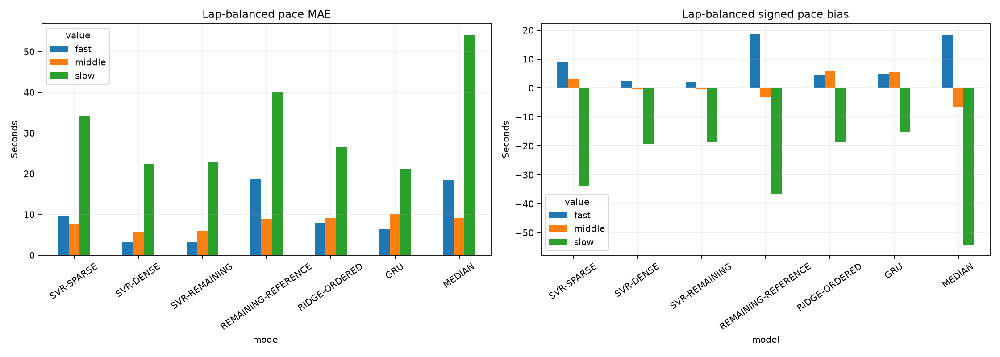
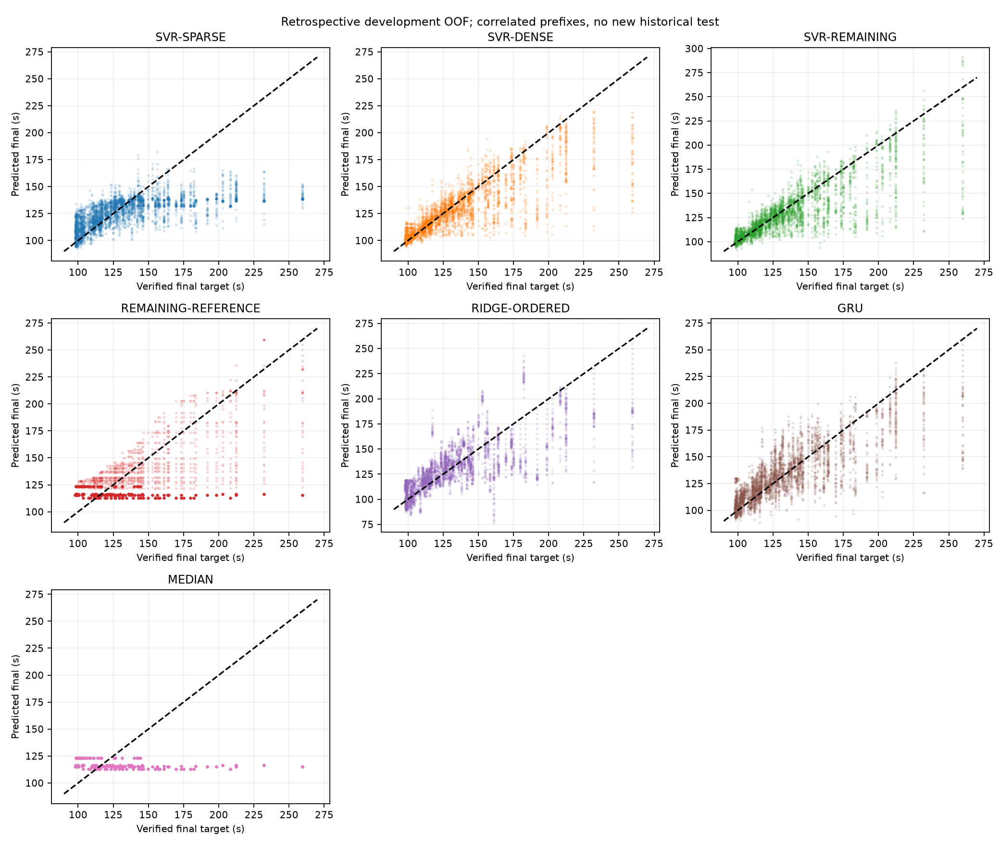
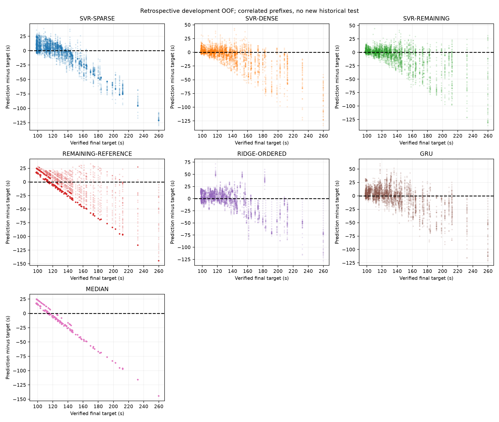
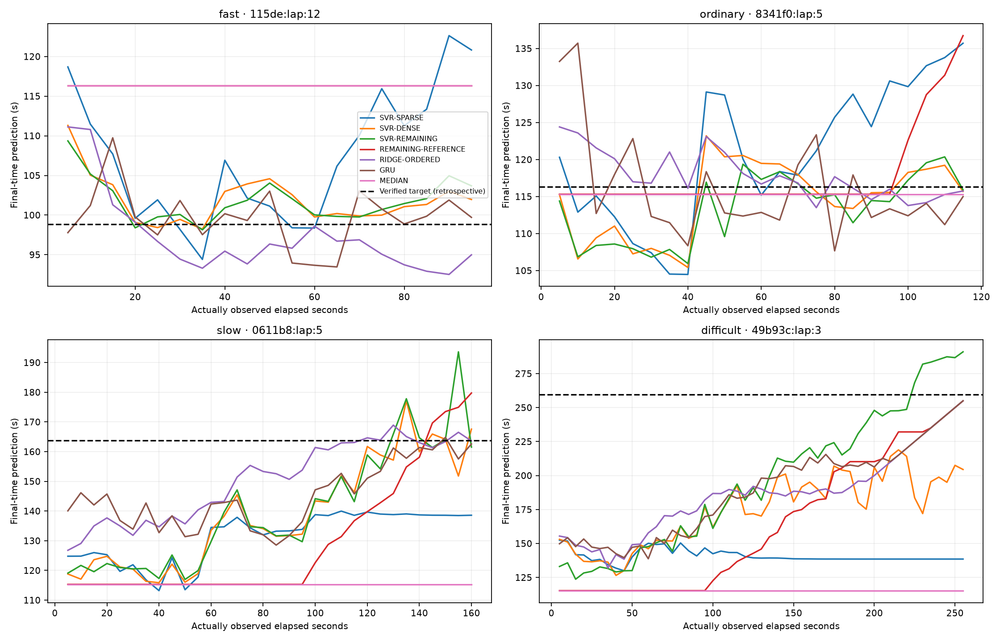

# ML comparison v0.8

All results below are exploratory **development OOF**, not a fresh independent test. All 169 development laps / 40 recording blocks are retained; 36 already-inspected historical test laps are excluded before representations. Source block independence is imperfect and folds overlap in fitting. Operational SVR v0.7.1 and its historical evidence remain unchanged.

| model | all_lap_balanced_MAE | same_5_60s_MAE | original_sparse_MAE | last_scheduled_MAE | final_10s_retrospective_MAE |
| --- | --- | --- | --- | --- | --- |
| SVR-SPARSE | 14.410 | 13.695 | 13.361 | 21.452 | 21.321 |
| SVR-DENSE | 8.602 | 12.836 | 13.058 | 3.227 | 3.591 |
| SVR-REMAINING | 8.733 | 13.502 | 13.587 | 4.066 | 4.416 |
| REMAINING-REFERENCE | 19.503 | 22.641 | 22.641 | 19.893 | 18.004 |
| RIDGE-ORDERED | 12.656 | 14.860 | 14.974 | 6.573 | 7.517 |
| GRU | 11.241 | 14.425 | 14.244 | 5.738 | 6.163 |
| MEDIAN | 22.641 | 22.641 | 22.641 | 22.641 | 22.641 |

Primary full-trajectory scores give each lap equal weight, irrespective of checkpoint count. RMSE, bias, median/P90/max, recording macro, calibration and spread are in the complete table below. Weighted quantiles interpolate centers of cumulative weights. Recording macro averages lap means within each block, then blocks equally. No prefix-based significance or confidence interval is claimed.

| model | mae_s | rmse_s | bias_s | median_absolute_error_s | p90_absolute_error_s | max_absolute_error_s | recording_macro_mae_s | prediction_to_target_std | predicted_on_actual_slope |
| --- | --- | --- | --- | --- | --- | --- | --- | --- | --- |
| SVR-SPARSE | 14.410 | 22.814 | -2.930 | 9.039 | 31.324 | 129.642 | 11.674 | 0.470 | 0.314 |
| SVR-DENSE | 8.602 | 16.126 | -3.522 | 3.773 | 21.597 | 133.080 | 7.709 | 0.751 | 0.638 |
| SVR-REMAINING | 8.733 | 16.430 | -3.566 | 4.037 | 21.567 | 135.877 | 7.867 | 0.797 | 0.668 |
| REMAINING-REFERENCE | 19.503 | 26.750 | -2.639 | 16.753 | 37.383 | 144.278 | 14.302 | 0.524 | 0.227 |
| RIDGE-ORDERED | 12.656 | 18.997 | -0.114 | 8.735 | 28.831 | 127.634 | 12.081 | 0.803 | 0.613 |
| GRU | 11.241 | 17.160 | 0.711 | 6.962 | 26.800 | 120.831 | 10.368 | 0.819 | 0.665 |
| MEDIAN | 22.641 | 32.010 | -8.047 | 17.367 | 48.596 | 144.278 | 15.982 | 0.130 | -0.048 |

## Early, middle and late actual elapsed seconds

| model | value | laps | snapshots | mae_s | bias_s |
| --- | --- | --- | --- | --- | --- |
| GRU | early_5_30 s | 169 | 1014 | 16.459 | -1.605 |
| GRU | late_over_60 s | 169 | 2106 | 8.786 | 0.852 |
| GRU | middle_35_60 s | 169 | 1014 | 12.392 | -0.782 |
| MEDIAN | early_5_30 s | 169 | 1014 | 22.641 | -8.047 |
| MEDIAN | late_over_60 s | 169 | 2106 | 22.641 | -8.047 |
| MEDIAN | middle_35_60 s | 169 | 1014 | 22.641 | -8.047 |
| REMAINING-REFERENCE | early_5_30 s | 169 | 1014 | 22.641 | -8.047 |
| REMAINING-REFERENCE | late_over_60 s | 169 | 2106 | 18.061 | 0.863 |
| REMAINING-REFERENCE | middle_35_60 s | 169 | 1014 | 22.641 | -8.047 |
| RIDGE-ORDERED | early_5_30 s | 169 | 1014 | 15.826 | -2.325 |
| RIDGE-ORDERED | late_over_60 s | 169 | 2106 | 11.156 | 0.338 |
| RIDGE-ORDERED | middle_35_60 s | 169 | 1014 | 13.893 | -1.575 |
| SVR-DENSE | early_5_30 s | 169 | 1014 | 15.326 | -8.591 |
| SVR-DENSE | late_over_60 s | 169 | 2106 | 5.637 | -1.953 |
| SVR-DENSE | middle_35_60 s | 169 | 1014 | 10.346 | -5.238 |
| SVR-REMAINING | early_5_30 s | 169 | 1014 | 16.209 | -11.144 |
| SVR-REMAINING | late_over_60 s | 169 | 2106 | 5.767 | -0.865 |
| SVR-REMAINING | middle_35_60 s | 169 | 1014 | 10.794 | -6.116 |
| SVR-SPARSE | early_5_30 s | 169 | 1014 | 15.897 | -5.672 |
| SVR-SPARSE | late_over_60 s | 169 | 2106 | 16.144 | 0.934 |
| SVR-SPARSE | middle_35_60 s | 169 | 1014 | 11.493 | -6.344 |

Selected actual-second checkpoints below make changing late coverage explicit.
The complete progression is in DEVELOPMENT_DETAILS_V080.csv. A255 s checkpoint
contains only one very slow lap; a small mean last-scheduled error across 169 laps
does not imply a small error on that lap.

| model | value | laps | mae_s | bias_s |
| --- | --- | --- | --- | --- |
| GRU | 5.0 | 169 | 19.581 | -0.716 |
| GRU | 10.0 | 169 | 18.681 | -2.129 |
| GRU | 30.0 | 169 | 12.550 | -1.063 |
| GRU | 60.0 | 169 | 11.992 | -1.298 |
| GRU | 90.0 | 169 | 9.751 | -1.498 |
| GRU | 120.0 | 76 | 14.274 | -2.564 |
| GRU | 180.0 | 10 | 15.914 | -13.737 |
| GRU | 240.0 | 1 | 19.605 | -19.605 |
| GRU | 255.0 | 1 | 4.605 | -4.605 |
| MEDIAN | 5.0 | 169 | 22.641 | -8.047 |
| MEDIAN | 10.0 | 169 | 22.641 | -8.047 |
| MEDIAN | 30.0 | 169 | 22.641 | -8.047 |
| MEDIAN | 60.0 | 169 | 22.641 | -8.047 |
| MEDIAN | 90.0 | 169 | 22.641 | -8.047 |
| MEDIAN | 120.0 | 76 | 33.797 | -33.797 |
| MEDIAN | 180.0 | 10 | 93.145 | -93.145 |
| MEDIAN | 240.0 | 1 | 144.278 | -144.278 |
| MEDIAN | 255.0 | 1 | 144.278 | -144.278 |
| REMAINING-REFERENCE | 5.0 | 169 | 22.641 | -8.047 |
| REMAINING-REFERENCE | 10.0 | 169 | 22.641 | -8.047 |
| REMAINING-REFERENCE | 30.0 | 169 | 22.641 | -8.047 |
| REMAINING-REFERENCE | 60.0 | 169 | 22.641 | -8.047 |
| REMAINING-REFERENCE | 90.0 | 169 | 22.641 | -8.047 |
| REMAINING-REFERENCE | 120.0 | 76 | 20.386 | -9.573 |
| REMAINING-REFERENCE | 180.0 | 10 | 18.419 | -4.266 |
| REMAINING-REFERENCE | 240.0 | 1 | 19.605 | -19.605 |
| REMAINING-REFERENCE | 255.0 | 1 | 4.605 | -4.605 |
| RIDGE-ORDERED | 5.0 | 169 | 18.342 | -2.887 |
| RIDGE-ORDERED | 10.0 | 169 | 18.335 | -2.997 |
| RIDGE-ORDERED | 30.0 | 169 | 14.404 | -1.725 |
| RIDGE-ORDERED | 60.0 | 169 | 13.471 | -1.149 |
| RIDGE-ORDERED | 90.0 | 169 | 12.189 | -1.025 |
| RIDGE-ORDERED | 120.0 | 76 | 16.860 | -4.757 |
| RIDGE-ORDERED | 180.0 | 10 | 26.877 | -18.609 |
| RIDGE-ORDERED | 240.0 | 1 | 19.605 | -19.605 |
| RIDGE-ORDERED | 255.0 | 1 | 4.605 | -4.605 |
| SVR-DENSE | 5.0 | 169 | 19.366 | -8.106 |
| SVR-DENSE | 10.0 | 169 | 20.614 | -13.757 |
| SVR-DENSE | 30.0 | 169 | 11.723 | -7.013 |
| SVR-DENSE | 60.0 | 169 | 9.435 | -3.952 |
| SVR-DENSE | 90.0 | 169 | 7.127 | -4.244 |
| SVR-DENSE | 120.0 | 76 | 9.713 | -4.657 |
| SVR-DENSE | 180.0 | 10 | 13.533 | -11.943 |
| SVR-DENSE | 240.0 | 1 | 60.754 | -60.754 |
| SVR-DENSE | 255.0 | 1 | 55.134 | -55.134 |
| SVR-REMAINING | 5.0 | 169 | 18.722 | -11.155 |
| SVR-REMAINING | 10.0 | 169 | 19.908 | -14.011 |
| SVR-REMAINING | 30.0 | 169 | 12.875 | -8.822 |
| SVR-REMAINING | 60.0 | 169 | 9.584 | -4.446 |
| SVR-REMAINING | 90.0 | 169 | 7.333 | -3.510 |
| SVR-REMAINING | 120.0 | 76 | 10.255 | -2.792 |
| SVR-REMAINING | 180.0 | 10 | 9.944 | -4.484 |
| SVR-REMAINING | 240.0 | 1 | 25.814 | 25.814 |
| SVR-REMAINING | 255.0 | 1 | 31.440 | 31.440 |
| SVR-SPARSE | 5.0 | 169 | 19.954 | -2.167 |
| SVR-SPARSE | 10.0 | 169 | 19.447 | -7.964 |
| SVR-SPARSE | 30.0 | 169 | 12.053 | -6.235 |
| SVR-SPARSE | 60.0 | 169 | 10.583 | -5.469 |
| SVR-SPARSE | 90.0 | 169 | 18.123 | 3.223 |
| SVR-SPARSE | 120.0 | 76 | 19.948 | -13.113 |
| SVR-SPARSE | 180.0 | 10 | 71.830 | -71.830 |
| SVR-SPARSE | 240.0 | 1 | 121.053 | -121.053 |
| SVR-SPARSE | 255.0 | 1 | 121.053 | -121.053 |

## Fast / middle / slow, without removing outliers

Descriptive thresholds are the frozen original TRAIN109.734/140.04333333333335 s, never features or held-out loss weights. Each band contains the same unique laps across candidates.

| model | value | laps | mae_s | bias_s |
| --- | --- | --- | --- | --- |
| GRU | fast | 62 | 6.324 | 4.895 |
| GRU | middle | 69 | 10.133 | 5.623 |
| GRU | slow | 38 | 21.274 | -15.034 |
| MEDIAN | fast | 62 | 18.432 | 18.432 |
| MEDIAN | middle | 69 | 9.068 | -6.447 |
| MEDIAN | slow | 38 | 54.154 | -54.154 |
| REMAINING-REFERENCE | fast | 62 | 18.622 | 18.622 |
| REMAINING-REFERENCE | middle | 69 | 8.984 | -2.995 |
| REMAINING-REFERENCE | slow | 38 | 40.042 | -36.679 |
| RIDGE-ORDERED | fast | 62 | 7.918 | 4.324 |
| RIDGE-ORDERED | middle | 69 | 9.241 | 6.125 |
| RIDGE-ORDERED | slow | 38 | 26.586 | -18.682 |
| SVR-DENSE | fast | 62 | 3.232 | 2.411 |
| SVR-DENSE | middle | 69 | 5.764 | -0.191 |
| SVR-DENSE | slow | 38 | 22.518 | -19.249 |
| SVR-REMAINING | fast | 62 | 3.136 | 2.159 |
| SVR-REMAINING | middle | 69 | 5.978 | -0.416 |
| SVR-REMAINING | slow | 38 | 22.869 | -18.628 |
| SVR-SPARSE | fast | 62 | 9.772 | 8.933 |
| SVR-SPARSE | middle | 69 | 7.612 | 3.328 |
| SVR-SPARSE | slow | 38 | 34.318 | -33.647 |

## Trajectory consistency and examples

Consecutive prediction-error improvements are measured per lap, then averaged across laps. No model is guaranteed to improve monotonically. Jumps show responsiveness and instability; smaller jumps alone are not accuracy. More cadence yields more feedback, not automatically smoother predictions.

| model | fraction_error_improved | mean_prediction_jump_s | max_prediction_jump_s | first_absolute_error_s | last_absolute_error_s |
| --- | --- | --- | --- | --- | --- |
| GRU | 0.539 | 4.583 | 16.359 | 19.581 | 5.738 |
| MEDIAN | 0.000 | 0.000 | 0.000 | 22.641 | 22.641 |
| REMAINING-REFERENCE | 0.112 | 0.989 | 7.471 | 22.641 | 19.893 |
| RIDGE-ORDERED | 0.560 | 2.513 | 10.822 | 18.342 | 6.573 |
| SVR-DENSE | 0.546 | 3.529 | 14.381 | 19.366 | 3.227 |
| SVR-REMAINING | 0.539 | 3.777 | 14.402 | 18.722 | 4.066 |
| SVR-SPARSE | 0.458 | 4.006 | 13.877 | 19.954 | 21.452 |

Examples are development10th/50th/90th-percentile nearest targets plus worst sparse-SVR mean trajectory error. This is a deterministic retrospective descriptive selection, not favorable cherry-picking or inference input.

## What is and is not isolated

Extra inference: exactly unchanged predictions at the original shared points. Dense fitting: compare matching observations, noting altered training distribution and effective total loss mass. Remaining target: same dense SVR information/weights/configuration, so target formulation is isolated within this setup. Ordered Ridge versus SVR changes representation and estimator simultaneously. GRU versus Ridge shares the same chunk information/remaining target, but training population, nonlinear architecture and regularization differ. No shuffled-order control is fitted, so the study cannot identify a pure effect of temporal ordering. No explicit track-progress feature is admitted.

The original operational SVR is not ranked using in-sample production predictions against OOF candidates. Its unchanged configuration is represented by OOF SVR-SPARSE, while the immutable artifact's separate66-lap validation trajectory is clearly labelled. New final-performance claims need genuinely untouched observations.

See [comparison](ML_COMPARISON_V080.md), [checkpoints](CHECKPOINT_STRATEGY_V080.md), [dense SVR](SVR_DENSE_EXPERIMENT_V080.md), [sequences](SEQUENCE_MODEL_EXPERIMENTS_V080.md), [protocol](ML_PROTOCOL_V080.json), [results/hashes](ML_RESULTS_V080.json) and [architecture](ARCHITECTURE_V080.md).
