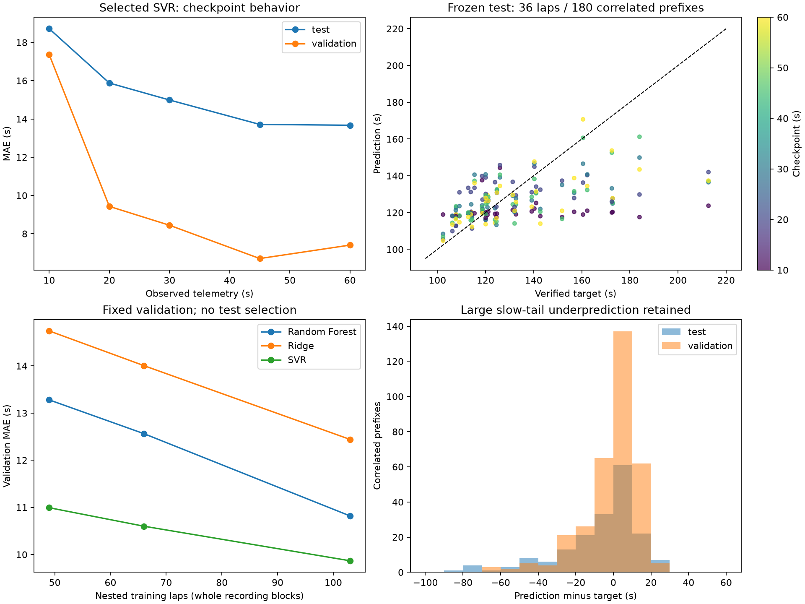

# Barcelona ML evaluation v0.7.1

**SVR was selected on validation MAE and evaluated once on the frozen test.**
Experiment A uses every technically valid training lap: 103 train, 66 validation,
36 test, five checkpoints per lap. No Monza/GT7 rows enter this experiment.

## Fixed implementation and decision order

The existing 13 causal features and 10/20/30/45/60 s checkpoints are unchanged.
Ridge alpha=10; Random Forest 120 trees/depth 6/minimum leaf 2/seed 42/one worker;
RBF SVR C=10/epsilon=0.5/default scale gamma. Imputation medians and Ridge/SVR
scalers fit TRAIN only. All models remain fitted on training; no final refit on
validation/test. Feature prefixes never receive targets, final distance, whole-lap
KPIs, future signals, participant names or source IDs as predictors.

The split is saved before fitting. Validation ranks MAE, RMSE, absolute bias,
then model name. The chosen experiment/model and validation evidence are saved
before the single final-test prediction. Ridge/RF have **validation results only**.
The selected SVR has validation and test results; test did not select it.

Experiment B was preregistered only for valid laps with measured positive timer
steps >100 ms, within the accepted 200 ms limit. **No training lap met that
category**, so no filtering comparison was invented and no valid lap excluded.
The implemented optional comparison uses identical inclusive validation/test,
requiring >=0.5 s and >=5% improvement on >=2 models, improved recording-macro
error and no >0.5 s slow-band degradation, followed by deterministic repetition.
See [filter decision](BARCELONA_FILTER_DECISION_V071.json).

## Measured validation (66 laps / 330 correlated prefixes / 10 blocks)

Errors are prediction minus verified target, seconds.

| model | mae_s | rmse_s | bias_s | median_absolute_error_s | p90_absolute_error_s | max_absolute_error_s | recording_macro_mae_s |
|---|---|---|---|---|---|---|---|
| Ridge | 12.441 | 15.986 | 6.102 | 9.897 | 24.466 | 59.858 | 13.622 |
| Random Forest | 10.819 | 15.240 | 3.531 | 8.292 | 24.709 | 69.317 | 13.142 |
| SVR | 9.868 | 14.928 | -0.820 | 5.766 | 22.022 | 69.628 | 11.007 |

## Selected SVR frozen test (36 laps / 180 correlated prefixes / 11 blocks)

| mae_s | rmse_s | bias_s | median_absolute_error_s | p90_absolute_error_s | max_absolute_error_s | recording_macro_mae_s |
|---|---|---|---|---|---|---|
| 15.393 | 22.396 | -6.442 | 9.353 | 36.705 | 88.939 | 12.646 |

Recording mean absolute errors range **5.047–31.637 s** on test. The pooled score
weights laps equally (each has five prefixes); recording-macro MAE weights blocks
equally. Unknown links limit independent-group interpretation. These are
descriptive results without prefix-based confidence intervals or significance claims.

## Deterministic baselines and matched coverage

Historical median is **122.164 s**, computed from unique training targets and fixed
before held-out evaluation. It is an offline pretraining reference; no absolute
acquisition chronology or online availability is claimed. Held-out targets never
update history. Previous-lap requires an earlier witnessed training lap in the
same capture, or a uniquely supported earlier training capture/date. Ambiguous
same-day capture order/date-conflict sources produce an unavailable previous-lap
reference, without borrowing validation/test labels.

| partition | baseline | coverage | laps | mae_s | rmse_s | bias_s | median_absolute_error_s | p90_absolute_error_s |
|---|---|---|---|---|---|---|---|---|
| test | previous_lap | 0.667 | 24 | 21.179 | 26.130 | -7.301 | 20.733 | 37.983 |
| test | historical_median | 1.000 | 36 | 17.901 | 26.664 | -10.481 | 10.207 | 50.346 |
| validation | previous_lap | 0.515 | 34 | 29.387 | 30.497 | 20.044 | 32.480 | 35.767 |
| validation | historical_median | 1.000 | 66 | 20.414 | 24.616 | 4.210 | 20.333 | 27.749 |

On all 36 test laps SVR improves median-reference MAE by **2.508 s (14.0%)**.
Previous-lap is available for 24/36 test laps: its MAE is **21.179 s**, versus
**16.486 s** for SVR on exactly those laps (gain 4.693 s). The 15.393 s overall SVR
score is a different population and must not replace the matched 16.486 s score.
Validation previous-reference coverage is 34/66 laps. See complete
[matched comparisons](BARCELONA_BASELINES_V071.csv).

## Checkpoints and legitimate pace tails

| partition | checkpoint_s | mae_s | rmse_s | bias_s |
|---|---|---|---|---|
| test | 10.000 | 18.717 | 27.591 | -11.788 |
| test | 20.000 | 15.876 | 22.302 | -3.688 |
| test | 30.000 | 14.989 | 21.014 | -4.731 |
| test | 45.000 | 13.713 | 20.078 | -5.888 |
| test | 60.000 | 13.670 | 20.115 | -6.113 |
| validation | 10.000 | 17.363 | 21.746 | 2.864 |
| validation | 20.000 | 9.427 | 15.320 | -2.401 |
| validation | 30.000 | 8.441 | 12.514 | -2.619 |
| validation | 45.000 | 6.701 | 10.490 | -1.548 |
| validation | 60.000 | 7.405 | 11.829 | -0.395 |

Test MAE declines 18.717 -> 13.670 s from 10 to 60 s; validation improves overall
17.363 -> 7.405 s, with a 45-to-60 s deterioration (6.701 -> 7.405). More telemetry
helps on aggregate but does not guarantee monotonically better individual estimates.

Pace bands use unique TRAIN Q25 **109.734 s** and Q75 **140.043 s**, frozen before
test. Fast <Q25, slow >Q75, remaining laps middle; none is removed.

| partition | value | laps | mae_s | bias_s | prediction_mean_s |
|---|---|---|---|---|---|
| test | fast | 5 | 9.633 | 9.633 | 116.264 |
| test | middle | 20 | 8.132 | 2.588 | 124.818 |
| test | slow | 11 | 31.213 | -30.167 | 133.241 |
| validation | fast | 36 | 6.007 | 5.191 | 106.760 |
| validation | middle | 18 | 7.018 | 2.997 | 124.911 |
| validation | slow | 12 | 25.723 | -24.577 | 136.591 |

## Model health and learning curve

1. **Baseline improvement exists**, but test error/tails remain large. SVR test
   MAE 15.393 s, RMSE 22.396 s and P90 36.705 s are insufficient for a precision
   race-engineering prediction claim.
2. **Central shrinkage persists.** At test 10 s prediction SD is 5.286 s versus
   target SD 24.866 s, centered at 120.857 s near the training median. At 60 s
   prediction SD expands to 13.103 s, still far below the target SD. Pooled test
   prediction range is 104.745–170.711 s despite targets reaching 212.650 s.
3. **Pace discrimination is partial.** Test fast/middle/slow mean predictions are
   116.264/124.818/133.241 s. Slow laps have MAE 31.213 s and bias -30.167 s;
   fast-lap bias is +9.633 s. Similar slow underprediction exists on validation.
4. **More same-domain training data helps overall validation**, for this nested
   seed-42 block curve. It does not uniformly help the slow tail, and a single
   ordering cannot separate sample-size effects from composition differences.

| model | training_groups | training_laps | mae_s | recording_macro_mae_s | slow_lap_mae_s |
|---|---|---|---|---|---|
| Ridge | 15 | 49 | 14.741 | 15.614 | 16.366 |
| Random Forest | 15 | 49 | 13.279 | 14.189 | 17.476 |
| SVR | 15 | 49 | 10.993 | 12.297 | 23.150 |
| Ridge | 22 | 66 | 14.005 | 14.789 | 16.792 |
| Random Forest | 22 | 66 | 12.563 | 13.269 | 18.435 |
| SVR | 22 | 66 | 10.600 | 11.527 | 23.497 |
| Ridge | 30 | 103 | 12.441 | 13.622 | 18.642 |
| Random Forest | 30 | 103 | 10.819 | 13.142 | 19.187 |
| SVR | 30 | 103 | 9.868 | 11.007 | 25.723 |

SVR validation MAE improves **10.993 -> 10.600 -> 9.868 s** for 49/66/103 train laps;
its slow-band MAE worsens **23.150 -> 23.497 -> 25.723 s**. Full-population train
MAE is 13.625 s (SVR), 9.755 s (RF), 16.625 s (Ridge). SVR's lower validation
than training error is consistent with differing pace/population composition;
it is not evidence that a train-only preprocessing check can be skipped.

5. **Large errors retain meaningful telemetry cases.** The largest test error
   (-88.939 s at 10 s) is capture `d83f92f1...`, source lap 1, target 212.650 s.
   Its first 10 s average 219.372 km/h, near-full throttle and no braking; at 60 s
   observed mean speed is 139.336 km/h and prediction remains 137.370 s.
   Aggregate prefixes lose phase/event ordering and cannot observe later incidents.
   This pattern is descriptive, not a confirmed cause or a license to remove it.
6. **The 13 features are a useful baseline but remain limiting.** Validation-only
   permutation importance ranks mean speed (+4.198 s MAE), mean throttle (+3.693 s)
   and high-throttle fraction (+2.351 s) highest. Features are correlated and five
   prefixes per lap are correlated; these are not causal effects. No feature
   selection was performed using these diagnostics.
7. **Next step: bounded causal feature engineering**, preserving this reference.
   Compare past-window speed/input/event summaries and verified source progress
   with validated semantics, without eventual-distance normalization. Evaluate
   checkpoint/slow-tail tradeoffs on development data and reserve a new final
   holdout for any changed model. Switching to deep learning is not supported
   merely by the current residuals.

[SVG export](figures/barcelona_health_v071.svg). All figures read already frozen
prediction tables; report generation does not run model inference. Full lap/block
metrics and median/P90/max errors are in [diagnostics](BARCELONA_DIAGNOSTICS_V071.csv),
[lap summaries](BARCELONA_BY_LAP_V071.csv), [recording summaries](BARCELONA_BY_SESSION_V071.csv)
and [individual causal rows](BARCELONA_PREDICTIONS_V071.csv).

## Reproduction and retained test

`python -m scripts.run_barcelona_v071` runs offline after explicit acquisition.
The initial local experiment has **test_evaluations=1**. Subsequent commands and
the dashboard verify frozen evidence hashes and reuse results; they do not choose
another model or re-evaluate the final batch. A missing local model can be rebuilt
using TRAIN only while retaining frozen evaluation CSVs. An interrupted test access
without completed results fails closed instead of silently consuming test again.
Artifacts live in ignored `artifacts/barcelona_v071/models`, signed by the existing
local SHA/HMAC store before deserialization, with car/track, schema, units, feature,
model/protocol and corpus identity checks. No historical model is overwritten.

The UI loads compatible local artifacts without fitting. Its explicit training
button creates the experiment on a fresh installation or reuses the frozen local
run. Progressive Prediction uses only observed prefixes and the selected model;
verified target/error appear only after retrospective reveal and never enter the
chart/hover payload. Interactive replay is separate from batch test evaluation.
