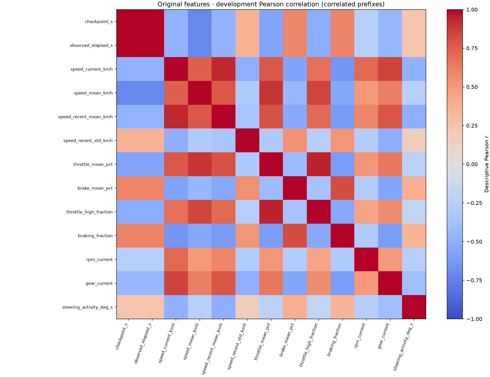
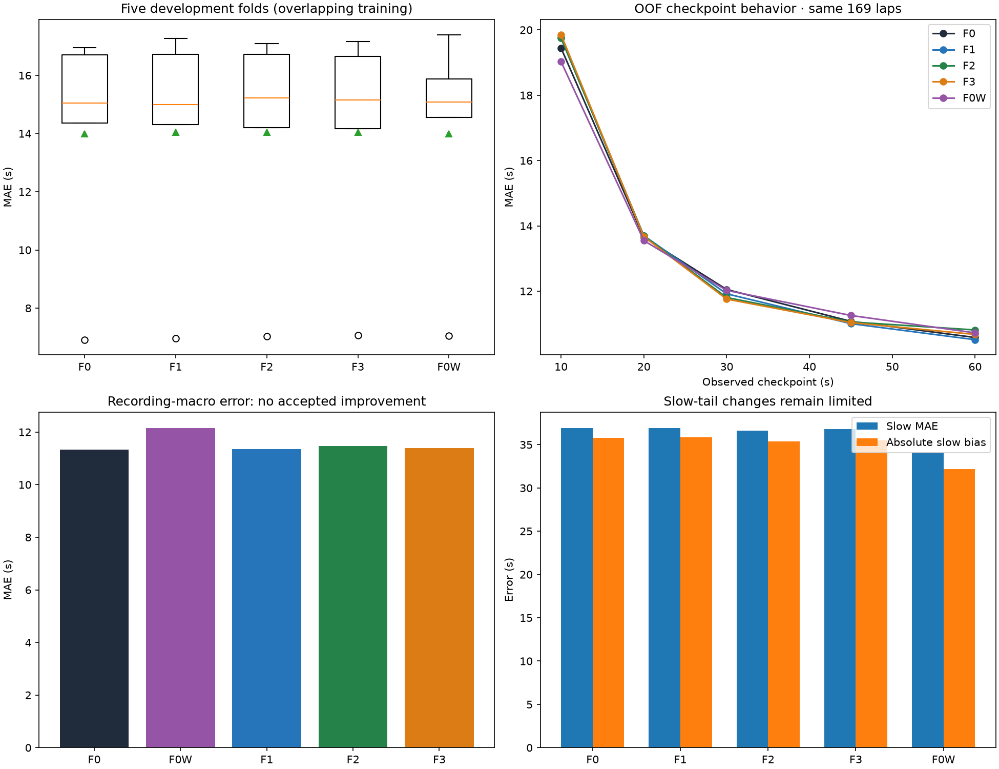
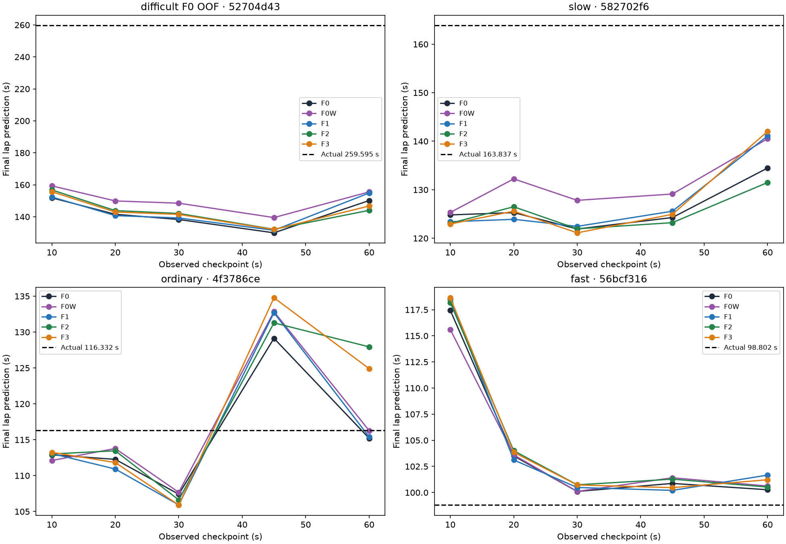

# Causal feature experiments v0.7.2

**No new feature variant qualifies for adoption.** Four fixed representations
and one independent weighting intervention were evaluated once on identical
development folds. The production v0.7.1 SVR remains unchanged.

## Original 13-feature audit

Features only receive the chronological prefix. All source units are checked by
the existing importer; optional gear/steering missing values are imputed using
fold training only. No participant/source identifiers, targets, next-lap timing,
whole-lap metrics or eventual distance enter the feature matrix.

| Feature | Physical interpretation / units | Source and calculation at checkpoint | Target relation, redundancy and information loss |
|---|---|---|---|
| checkpoint_s | Requested observed horizon, s | Fixed 10/20/30/45/60 s | Same five horizons for every lap; context for interactions, not a standalone pace label; nearly duplicates observed elapsed |
| observed_elapsed_s | Last available source lap timer, s | Final timestamp in permitted causal prefix | Close to checkpoint with source-grid offset; no final time; near duplicate can emphasize time in kernel geometry |
| speed_current_kmh | Current ground speed, km/h | Last valid observed Ground Speed | Instantaneous phase/pace cue; cannot describe prior braking or later incidents; correlated with RPM/gear |
| speed_mean_kmh | Mean observed speed, km/h | Forward time-weighted left-hold mean from lap start; terminal sample has zero duration | Strong pace cue, averages away order and phase; partly redundant with distance/time and recent speed |
| speed_recent_mean_kmh | Recent speed, km/h | Same weighting over trailing 3 s ending at last observed timestamp | Local phase cue; loses within-window order; correlated with current and global speed |
| speed_recent_std_kmh | Recent speed variability, km/h | Weighted population SD in same trailing 3 s | Slowing/acceleration magnitude without direction; two reversed histories may match |
| throttle_mean_pct | Observed throttle utilization, % | Time-weighted Throttle Pos over prefix | Control/pace cue but loses burst ordering and subsequent recovery; correlated with high-throttle fraction |
| brake_mean_pct | Observed brake intensity, % | Time-weighted Brake Pos over prefix | Combines braking strength and duration; cannot distinguish number/order of phases; correlated with brake-on fraction |
| throttle_high_fraction | High-throttle time, fraction | Weighted fraction Throttle Pos >=90% | Describes already observed commitment; threshold compresses pedal magnitude/order; overlaps mean throttle |
| braking_fraction | Brake-on time, fraction | Weighted fraction Brake Pos >=5% | Preserves total brake-on support, not events or timing; overlaps mean brake |
| rpm_current | Current engine speed, rpm | Last observed Engine RPM | Speed/gear/driver cue; cannot describe earlier shift history or later driving |
| gear_current | Current reported gear, source category | Last observed Gear, no invented gear remapping | Discrete speed/phase cue, overlaps RPM/speed; optional missing values use fold-training imputation |
| steering_activity_deg_s | Recent steering activity, deg/s | Sum of absolute Steering Angle changes / positive duration over trailing 3 s, only with declared degrees | Turn/input cue without direction/order; export noise can matter; optional absence stays missing |

Correlation/information diagnostics use development only, one lap per checkpoint
for target associations. [Feature information](FEATURE_INFORMATION_V072.csv)
records Pearson/Spearman and seed-42 kNN mutual information. They are descriptive
associations, not causal effects; laps share recording conditions, and pooling
the five prefixes would overstate independent sample size. Constant features
receive zero reported mutual information.

The checkpoint/observed-time Pearson correlation is **0.999999942**. Current speed,
recent/global speed, RPM/gear and pedal means/fractions also overlap. No correlated
feature was automatically removed. A removal study would be a separate controlled
experiment; the preregistered small experiment set was not expanded post-score.

Development pairs support the compression concern without proving its cause:

- At 10 s, different blocks have mean speeds **227.061 / 226.636 km/h**, full
  throttle, no braking and nearly matching recent speed, yet targets
  **142.542 / 102.793 s**. The full original feature distance is only 0.018 in
  TRAIN-standardized coordinates. Very similar observed prefixes cannot reveal
  a later incident with certainty, even with a sequence model.
- At 45 s another pair has nearly equal mean speed
  **169.438 / 169.482 km/h** and throttle
  **60.033 / 60.263%**, but
  **3 / 4** brake
  phases and **0.000 / 1.600 s**
  below 80 km/h, with targets **110.317 / 135.822 s**.
  Similar means do not imply identical ordered behavior. The remaining original
  features can also differ; this is not proof that the full 13-vector is identical
  or that the added descriptors must improve prediction. Exact pairs are in
  [original neighbors](FEATURE_SIMILAR_LAPS_V072.csv) and
  [temporal pairs](FEATURE_TEMPORAL_PAIRS_V072.csv).

## New definitions and limited experiment set

| Family / features | Definition and units | Causal boundary / limitations |
|---|---|---|
| F1 speed_mean_5s_kmh, speed_std_5s_kmh | Weighted mean / population SD of trailing ground speed, km/h | Actual left-hold intervals clipped to [checkpoint-5,last observation]; no centered window |
| F1 speed_delta_5s_kmh | Current minus last-known speed at window start, km/h | Backward lookup, no future interpolation; order-sensitive net change |
| F1 deceleration_mean_5s_mps2, deceleration_max_5s_mps2 | Positive part of -(v[i+1]-v[i])/(3.6*actual_dt), weighted mean / maximum in window | Both timestamps already observed; dt>0; estimated export derivative, not a calibrated accelerometer |
| F1 braking_fraction_5s, throttle_mean_5s_pct | Weighted fraction brake>=5%, and mean throttle % | Supported trailing intervals only; terminal sample has no invented duration |
| F2 braking_phases_count | Number of observed brake>=5% runs with >=0.2 s already witnessed | Ongoing run counts only after observed duration qualifies; no future completion confirmation |
| F2 low_speed_observed_s, severe_slow_observed_s | Observed supported seconds below 80 / 40 km/h | Fixed physical low/severe-slow descriptors; no lap removed; missing values are not interpolated |
| F2 recovery_from_low_kmh | Current minus speed at most recent below-80 sample; nonnegative, 0 while low/no prior low | Captures already observed recovery only; future slowing remains unknown |
| F2 distance_observed_m | Sum(v_left * positive actual_dt)/3.6, metres | Observed ground-speed path-distance proxy; no track length, future distance, normalized fraction or coordinates |

F0: 13 original features. F1: original + seven trailing-window features (**20**).
F2: original + five event/distance summaries (**18**). F3: their union (**25**).
F0W: the original **13** features with one training-only loss-weight intervention.
Feature identity is `causal-prefix-v072-1`; complete names/units and protocol are
bound to the signed experimental artifact. F0 calls the original feature builder
unchanged, verified bit-for-bit at every checkpoint.

Window intervals straddling the lower boundary are clipped by time; a last-known
sample before that boundary may support the beginning of the interval. No future
right-neighbor or centered interpolation is used. Prefix source-clock gaps over
200 ms and invalid boundaries fail the unchanged causal quality check. There is
no assumed uniform sample count and no imputed final interval.

Thresholds are fixed before fitting: 5% brake follows the original convention;
0.2 s excludes isolated export packets from an event count; 80/40 km/h describe
low/severe slowing in this formula-car domain. They are descriptors, not exclusion
rules or thresholds fitted to validation/test errors.

## Progress investigation and feature-quality limitations

`Car Pos Norm` is present. A development-only inspection covers all **169 laps**;
19 have some decreasing source-prefix steps. Reverse/recovery motion can be
legitimate and was not removed or forced monotonic. The author's
[NeurIPS paper, Appendix F](https://proceedings.neurips.cc/paper_files/paper/2024/file/b91ea2ba1b6521940e204b7b81d5ef47-Paper-Datasets_and_Benchmarks_Track.pdf)
describes a normalized spline-position API and ACTI human-data recording, but does
not independently establish the exact `Car Pos Norm` export mapping or resampling
semantics. **F4 raw normalized progress was therefore omitted as preregistered**;
bounded values alone are insufficient to assert that mapping. This does not block
any valid lap or the other experiments. The speed-integral proxy needs neither
a track constant nor eventual completed distance; it is not a certified track phase.

The distance proxy is largely a nonlinear interaction of mean speed and observed
duration, not necessarily independent information. At 10 s all 169 development
laps have zero sustained braking, zero below-80 duration and zero below-40 duration:
the event family cannot distinguish those early prefixes. At 60 s below-80 duration
has Spearman association **0.820** with final time, but is related to existing
speed/input aggregates and does not guarantee incremental SVR benefit.

Raw deceleration estimates also contain extreme spikes: one development source
drops **87.235 -> 56.105 km/h over 0.020 s**, yielding **432.361 m/s²** at 59.2825 s.
The cause is unestablished (possible collision/recovery or export effects);
this is not a calibrated braking-acceleration reading. No post-score clipping,
lap deletion or redesigned retry was performed. This limitation may impair F1,
but its effect is not isolated by the current experiment. See
[new-feature distributions](FEATURE_NEW_INFORMATION_V072.csv),
[source inspection](PROGRESS_SOURCE_AUDIT_V072.csv) and
[reproducible spike evidence](FEATURE_SPIKE_CASE_V072.json).

## Exact development protocol

The original TRAIN+validation pool supplies **169 laps / 40 recording blocks /
845 correlated snapshots**. The historical 36 test laps are excluded **before
feature generation**. Sort block IDs, seed-42 permute, assign index modulo five.
Every fold has eight held-out blocks; held-out lap counts are **16/30/33/47/43**.
All prefixes of a lap and all known-linked captures remain together. No driver
stratification or identity certainty requirement is introduced.

All variants use RBF SVR C=10, epsilon=0.5, gamma=scale, fold-training median
imputation and fold-training standard scaling; no parameter grid or refit on a
fold's held-out observations. Gamma's default adapts to the number of scaled
features: added correlated/noisy dimensions change kernel geometry, so this study
does not isolate representation from every regularization effect. It does
establish the outcome of the fixed, fair, limited configurations tested.

Comparison bands use the original TRAIN Q25/Q75 for common descriptive reporting.
Those constants are not predictive inputs or loss weights. Fold preprocessing,
loss weights and deterministic baseline histories see only the fold's training
population. Complete [membership](DEVELOPMENT_FOLDS_V072.csv),
[fit metadata](DEVELOPMENT_PREPROCESSING_V072.csv), [freeze](DEVELOPMENT_FREEZE_V072.json)
and [protocol](ML_PROTOCOL_V072.json) precede the fitted experiment.

## Actual out-of-fold results (same population for every variant)

| variant | mae_s | rmse_s | bias_s | median_absolute_error_s | p90_absolute_error_s | max_absolute_error_s | recording_macro_mae_s | prediction_to_target_std | predicted_on_actual_slope |
|---|---|---|---|---|---|---|---|---|---|
| F0 | 13.361 | 22.860 | -6.280 | 6.898 | 34.137 | 129.642 | 11.332 | 0.511 | 0.351 |
| F0W | 13.317 | 22.160 | -4.436 | 7.156 | 33.137 | 120.101 | 12.155 | 0.583 | 0.397 |
| F1 | 13.381 | 22.941 | -6.318 | 6.752 | 34.210 | 128.053 | 11.361 | 0.515 | 0.351 |
| F2 | 13.424 | 22.847 | -6.077 | 6.853 | 34.523 | 127.409 | 11.472 | 0.521 | 0.355 |
| F3 | 13.400 | 22.927 | -6.159 | 6.747 | 33.927 | 127.550 | 11.385 | 0.521 | 0.353 |

Fold variation is large compared with the feature changes:

| variant | mean | std | min | max |
|---|---|---|---|---|
| F0 | 13.998 | 4.108 | 6.914 | 16.957 |
| F0W | 13.990 | 4.024 | 7.054 | 17.400 |
| F1 | 14.051 | 4.144 | 6.960 | 17.270 |
| F2 | 14.052 | 4.097 | 7.024 | 17.091 |
| F3 | 14.038 | 4.079 | 7.058 | 17.161 |

Means/std in this table treat the five fold scores equally; pooled MAE weights
their unequal lap counts. Folds overlap in fitting data and are not independent
replications. No narrow prefix-based confidence interval or formal significance
claim is made. F0 fold MAE ranges **6.914–16.957 s**; the new-family pooled changes
are only **+0.020/+0.063/+0.039 s**. F1/F3 improve two folds, F2 one.

| variant | value | laps | mae_s | bias_s |
|---|---|---|---|---|
| F0 | fast | 62 | 5.257 | 4.452 |
| F0 | middle | 69 | 7.668 | 0.335 |
| F0 | slow | 38 | 36.922 | -35.804 |
| F0W | fast | 62 | 5.118 | 4.197 |
| F0W | middle | 69 | 9.231 | 3.097 |
| F0W | slow | 38 | 34.115 | -32.200 |
| F1 | fast | 62 | 5.278 | 4.326 |
| F1 | middle | 69 | 7.710 | 0.365 |
| F1 | slow | 38 | 36.899 | -35.820 |
| F2 | fast | 62 | 5.424 | 4.517 |
| F2 | middle | 69 | 7.824 | 0.523 |
| F2 | slow | 38 | 36.646 | -35.344 |
| F3 | fast | 62 | 5.439 | 4.347 |
| F3 | middle | 69 | 7.682 | 0.546 |
| F3 | slow | 38 | 36.772 | -35.474 |

## Weighting is separate, not a filtered dataset

F0W derives its Q25/Q75 from unique **fold-training** targets and assigns
`n_training_laps / (3*n_class_laps)` per lap, normalized to mean snapshot weight one.
Each lap's five prefixes share its weight; no lap gains weight merely from
duplicate prefix counting. Imputation/scaling remain unweighted and identical
to F0. Validation/test labels never set weights. All valid laps remain.

The intervention addresses middle-band loss dominance and observed development
slow bias, not absent slow examples. It improves pooled MAE by only **0.044 s
(0.33%)**, improves only **one of five folds**, and worsens recording-macro MAE
**11.332 -> 12.155 s**. Slow MAE improves **36.922 -> 34.115 s** and slow bias
**-35.804 -> -32.200 s**, while middle MAE worsens **7.668 -> 9.231 s**. SD ratio
increases 0.511 -> 0.583 and calibration slope 0.351 -> 0.397, but greater spread
does not establish a better overall model. Weighting is retained as an informative
negative tradeoff and is not adopted.

## Baselines, checkpoint/lap/recording behavior and examples

Each fold's median reference uses unique fold-training targets only. On all 169
OOF laps its MAE is **22.641 s**, versus **13.361 s** for F0. Previous-lap is
available for **64/169 laps**, with MAE **24.310 s** versus **10.086 s** for F0 on
the same available rows. Missing chronological evidence produces unavailable,
not borrowed held-out targets. [Matched fold baselines](DEVELOPMENT_BASELINES_V072.csv)
retain coverage; pooled scores cannot substitute for matched-population scores.

[Detailed checkpoint/lap/block/pace metrics](DEVELOPMENT_DETAILS_V072.csv) include
MAE/RMSE/bias/median/P90/max, spread and calibration. No individual high-error
lap or recording is dropped. The deterministic illustrations are development
10th/50th/90th-percentile nearest targets (98.803/116.333/163.837 s) plus the
worst F0 OOF lap (259.595 s), with all five variants and all checkpoints shown.
They were not selected for favorable prediction gains.

## Decision and reproducibility

Adoption required >=0.5 s and >=5% pooled MAE gain, >=0.25 s recording-macro gain,
improvement in >=4/5 folds and no >0.5 s worsening in slow MAE/absolute bias.
**None qualifies; F0 remains selected.** No new experimental engine replaces
production. No failed variant is hidden and no further search was added.

`python -m scripts.run_barcelona_v072` verifies/reuses frozen development evidence.
Missing local research artifacts can be rebuilt on DEVELOPMENT only without
rescoring folds or historical test. `python -m scripts.report_barcelona_v072`
regenerates these reports/PNG/SVG from tables without model inference.
`python -m scripts.verify_baselines_v072` verifies historical Monza/GT7 and the
Barcelona reference. [Frozen preservation](BASELINE_PRESERVATION_V072.json) retains
original file/model hashes; original v0.7.1 test count stays one and new experimental
historical-test evaluations stay **zero**.
