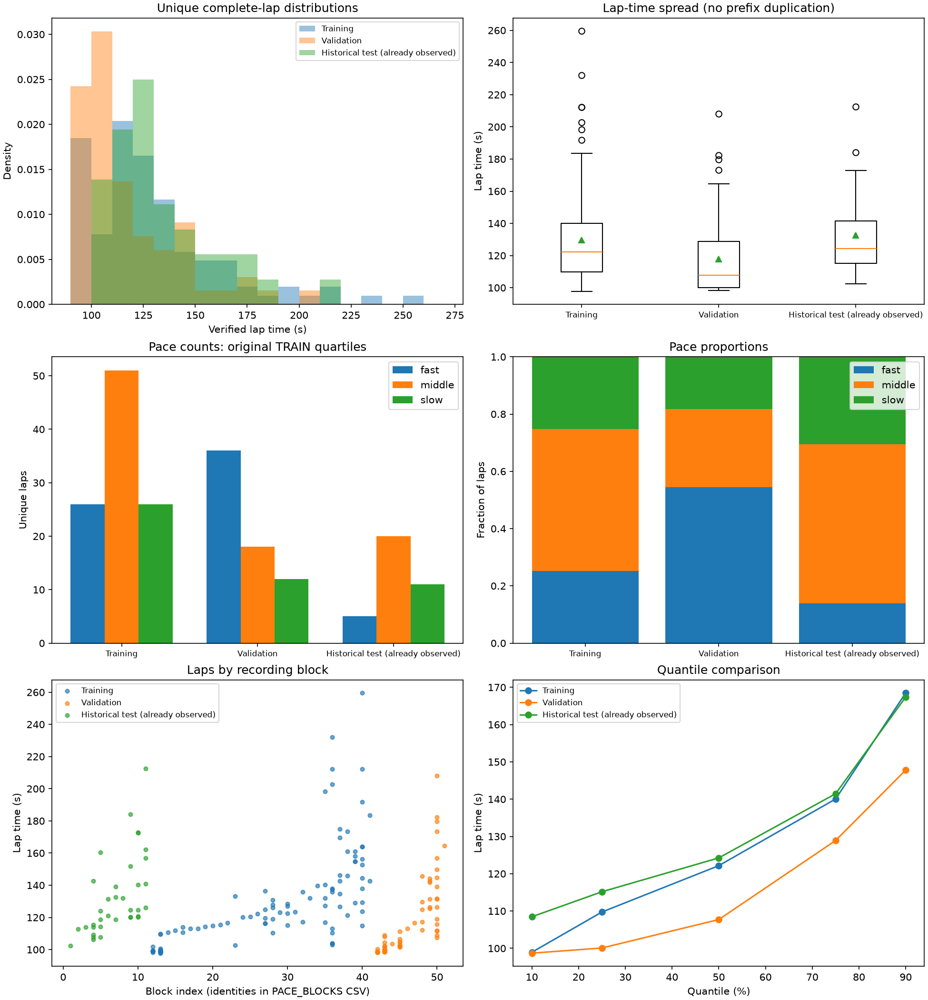
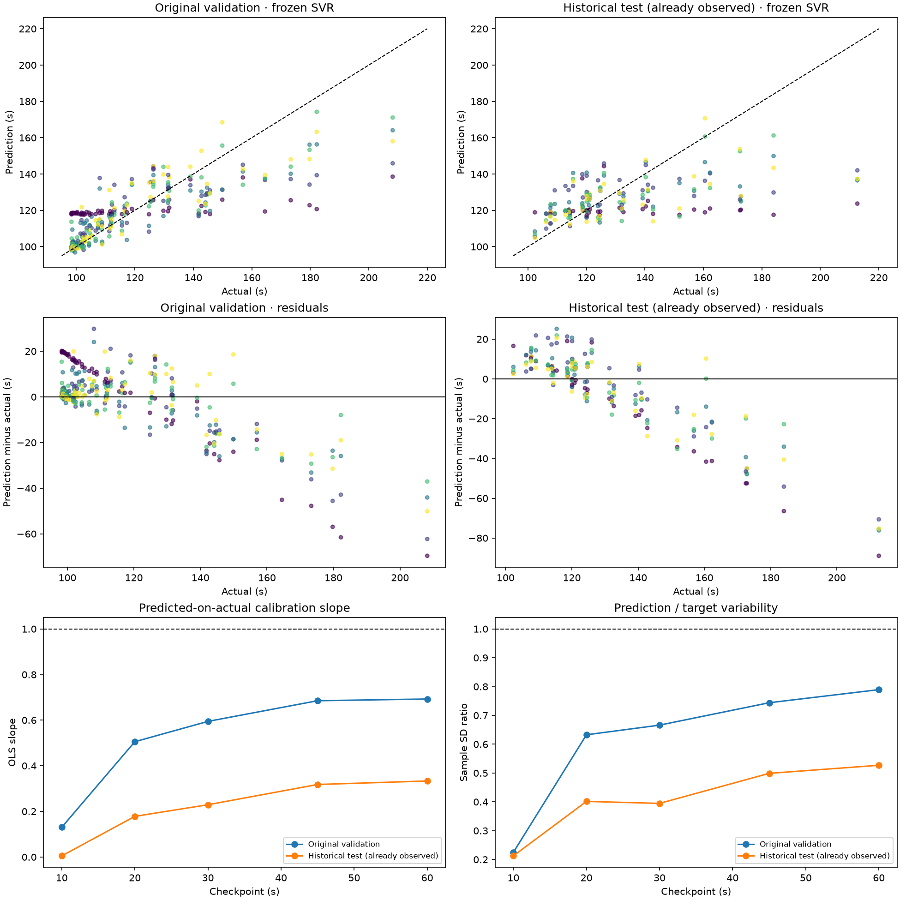

# Pace distribution and reference diagnosis v0.7.2

The model is exposed to slow laps: **26/103 training laps (25.24%)**, across seven
recording blocks, exceed the original training Q75. Training includes the slowest
valid lap, 259.595 s, compared with historical-test maximum 212.650 s. Lack of
any slow training examples or an insufficient target range is not supported.
Representation within individual driving/recording conditions remains limited.

## Unique-lap distributions and metadata

Counts are complete **unique laps**, not five correlated prefixes per lap.
Exact frozen memberships and verified source targets are reloaded rather than
using rounded narrative values. Recomputed common thresholds are Q25
**109.734 s**, Q75 **140.04333333333335 s**, matching v0.7.1 within 1e-10 s.
Fast is strictly below Q25, slow strictly above Q75; the boundary values are middle.

| partition | laps | recording_blocks | mean_s | median_s | std_s | min_s | max_s | q10_s | q25_s | q50_s | q75_s | q90_s |
|---|---|---|---|---|---|---|---|---|---|---|---|---|
| test | 36 | 11 | 132.645 | 124.247 | 24.866 | 102.350 | 212.650 | 108.460 | 115.168 | 124.247 | 141.459 | 167.388 |
| train | 103 | 30 | 129.754 | 122.164 | 31.541 | 97.768 | 259.595 | 98.936 | 109.734 | 122.164 | 140.043 | 168.503 |
| validation | 66 | 10 | 117.954 | 107.710 | 24.439 | 98.313 | 208.183 | 98.695 | 100.087 | 107.710 | 128.912 | 147.812 |

`test` in every table means **historical test, already observed**. It is never a
new independent test in v0.7.2.

| partition | pace_band | laps | proportion | recording_blocks |
|---|---|---|---|---|
| test | fast | 5 | 0.139 | 3 |
| test | middle | 20 | 0.556 | 10 |
| test | slow | 11 | 0.306 | 5 |
| train | fast | 26 | 0.252 | 4 |
| train | middle | 51 | 0.495 | 28 |
| train | slow | 26 | 0.252 | 7 |
| validation | fast | 36 | 0.545 | 5 |
| validation | middle | 18 | 0.273 | 6 |
| validation | slow | 12 | 0.182 | 4 |

Training: 26 fast / 51 middle / 26 slow. Validation: **36 / 18 / 12**, verified.
Historical test: **5 / 20 / 11**, verified. Validation is 54.55% fast, versus
13.89% on historical test; slow proportions are 18.18% versus 30.56%.
Source codes and uncertainties are:

| partition | codes | uncertain_laps |
|---|---|---|
| test | acgym:HC, acgym:NH, acgym:ST, acgym:XX | 14 |
| train | acgym:A, acgym:AB, acgym:HC, acgym:KW, acgym:RRK, acgym:XX | 69 |
| validation | acgym:A, acgym:AB, acgym:IN, acgym:OP, acgym:WL, acgym:XX | 34 |

Codes A/XX and date conflicts do not become invented people. Stints in explicit
recording folders stay together; XX captures use their actual export blocks.
The 51 total blocks are not 51 certified independent physical sessions.
[Per-block lap ranges](PACE_BLOCKS_V072.csv), [lap-level membership](PACE_LAPS_V072.csv)
and original-source flags preserve what is known. No usable lap is deleted.

## Does distribution composition plausibly contribute to the error gap?

Yes, descriptively. Frozen validation MAE is **9.868 s**,
historical test MAE **15.393 s**. Applying frozen
validation *band-specific errors* to the historical test's observed band proportions
gives **12.593 s**.
That descriptive composition difference is **2.726 s**;
**2.800 s** remains from differing
within-band outcomes. This assumes unchanged conditional errors, which the actual
data does not establish; it is **not a causal decomposition**, a corrected test
score, training weights or evidence that rebalancing fixes the model. The small
numbers of slow-lap blocks and uncertain cross-capture links limit attribution.

## Is the reference implementation defective or using the baseline as its target?

No structural target/baseline defect was found. The existing pipeline fits
`model.fit(X[13 causal columns], target_s)` and returns direct final seconds.
There is no median subtraction/addition or baseline column in X. Historical median
is a separate frozen TRAIN reference, **122.164 s**, computed from unique permitted
training targets. Previous-lap history has separate chronological/capture guards.
The signed artifact and all 1,170 stored v0.7.1 evaluation rows are preserved.

Telemetry matters: a controlled +/-10 km/h change to already observed speed in
three deterministic development laps changes predictions. For the median-pace
development example at 60 s, predictions are **120.131 / 116.833 / 114.045 s** for
-10 / unchanged / +10 km/h. This is input sensitivity, not a physical intervention
or new validation score. Frozen validation SVR MAE 9.868 s already beats its
20.414 s median reference; the new group-CV comparison separately verifies utility.

## Central shrinkage and checkpoint spread

OLS slopes regress **prediction on actual target**, so a slope below one indicates
compressed responses; this is not the inverse calibration regression.

| partition | checkpoint_s | prediction_mean_s | target_std_s | prediction_std_s | prediction_to_target_std | predicted_on_actual_slope |
|---|---|---|---|---|---|---|
| test | 10.000 | 120.857 | 24.866 | 5.286 | 0.213 | 0.005 |
| test | 20.000 | 128.957 | 24.866 | 9.985 | 0.402 | 0.178 |
| test | 30.000 | 127.915 | 24.866 | 9.815 | 0.395 | 0.229 |
| test | 45.000 | 126.757 | 24.866 | 12.406 | 0.499 | 0.318 |
| test | 60.000 | 126.532 | 24.866 | 13.103 | 0.527 | 0.333 |
| validation | 10.000 | 120.818 | 24.439 | 5.492 | 0.225 | 0.130 |
| validation | 20.000 | 115.553 | 24.439 | 15.463 | 0.633 | 0.506 |
| validation | 30.000 | 115.335 | 24.439 | 16.281 | 0.666 | 0.595 |
| validation | 45.000 | 116.406 | 24.439 | 18.181 | 0.744 | 0.685 |
| validation | 60.000 | 117.559 | 24.439 | 19.290 | 0.789 | 0.693 |

At 10 s predictions cluster near 121 s, with SD around 5.3–5.5 s. At historical
test 60 s the SD ratio is 0.527 and slope 0.333; original validation reaches
0.789 and 0.693. Increasing spread is useful only when accompanied by lower error
and better calibration, not merely less constant outputs.

These patterns support central regression with limited predictive information,
fixed SVR regularization/kernel geometry, recording shift and unobserved future
events as plausible contributors. They do not identify a single cause. Slow-lap
underprediction exists in development too; historical-test distribution alone
cannot explain it. No experimental model is scored on the historical test.
