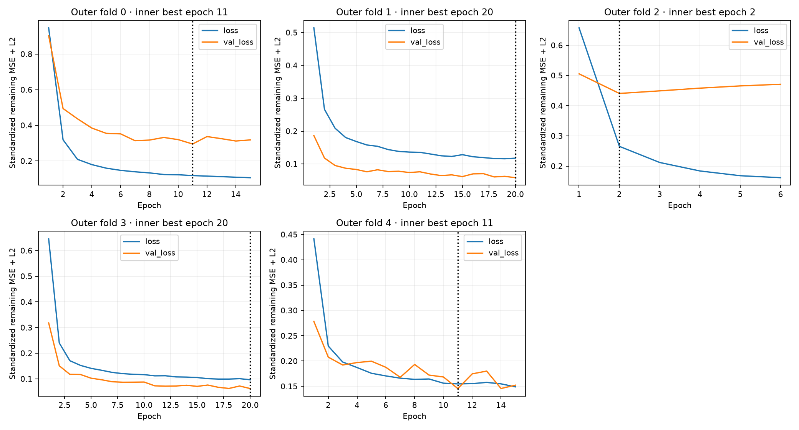

# Ordered-window and GRU experiments v0.8

All results below are exploratory **development OOF**, not a fresh independent test. All 169 development laps / 40 recording blocks are retained; 36 already-inspected historical test laps are excluded before representations. Source block independence is imperfect and folds overlap in fitting. Operational SVR v0.7.1 and its historical evidence remain unchanged.

## Shared causal representation

Six channels: validated speed km/h, throttle/brake%, RPM, gear, steering degrees when declared. At 10 Hz use only the last known source sample, at most 200 ms old. No future neighbor or gap interpolation. Append the actual terminal observation when off-grid. Compress the entire observed prefix into ordered nonoverlapping 2 s chunks: six means, six availability fractions and observed chunk duration/2. No prefix is truncated at 60 s. Fixed support 600 s/301 chunks is a model contract, independent of the eventual evaluated lap length. The last partial chunk is retained.

This is a compact sequence of actual observations, not raw 10 Hz input to the recurrent layer. Compression loses sub 2 s order and is an explicit CPU/memory tradeoff. Chronological chunks retain whole-prefix order. Core source defects reject the same checkpoint for all candidates; optional channels remain missing, with indicators and training-only imputation. Zero padding has a separate boolean mask; genuine zero-valued telemetry remains observed.

Sequence means/std/imputation use longest-prefix training chunks once per lap, without duplicated-prefix statistics or padding. Context uses the same 13 original causal features, with training-only imputer/scaler. Ridge and GRU receive the same chunk information and context at exactly the same observation cutoff. Ridge flattens ordered chunks with fixed padding/masks; GRU consumes variable-length chunks and explicit masks. No target-normalized sequence length exists.

## Fixed candidates and actual training

RIDGE-ORDERED: alpha 100, standardized chunk values and context, remaining-time target, lap-balanced loss. GRU: one 16-unit Keras GRU, L2=.001, concatenated context, Dense8 ReLU and linear output; **1737 trainable parameters**. Predict standardized remaining seconds, invert using training-only weighted mean/std, then add observed elapsed and explicitly project negative remaining values. Adam.003 clipnorm1, MSE, batch 64, max 20 epochs, seed42+fold, early-stop patience 4, restore best weights. One architecture, no search.

Reuse five outer recording folds. GRU reserves four outer-training blocks for early stopping, fits all preprocessing/output transforms on the other 28 blocks, and never monitors outer held-out loss. Classical models fit all 32 outer-training blocks. This common outer evaluation is fair as a comparison of practical training procedures; **it does not isolate architecture causally**, because GRU has fewer fitting laps and a different regularizer. No superiority is attributed solely to temporal order or neural recurrence.

Existing Keras 3.15.1/Torch 2.14.1 CPU backend, two Torch threads, deterministic algorithms. No CUDA/container/GPU install. Keras and Torch load only for explicit training or GRU selection. Record actual cumulative process peak working set (includes corpus, sklearn and Keras, not GRU-exclusive memory), tensor sizes and per-fold durations:

| fold | fit_laps | fit_blocks | inner_validation_laps | epochs_ran | best_epoch | seconds | classical_seconds | parameter_count | process_peak_working_set_bytes | padded_fit_tensor_bytes | padded_steps |
| --- | --- | --- | --- | --- | --- | --- | --- | --- | --- | --- | --- |
| 0 | 123 | 28 | 30 | 15 | 11 | 117.211 | 1.670 | 1737 | 668561408 | 19715024 | 128 |
| 1 | 124 | 28 | 15 | 20 | 20 | 138.006 | 1.535 | 1737 | 935219200 | 20870308 | 128 |
| 2 | 131 | 28 | 5 | 6 | 2 | 46.387 | 1.170 | 1737 | 935219200 | 21143748 | 128 |
| 3 | 104 | 28 | 18 | 20 | 20 | 107.922 | 1.105 | 1737 | 935219200 | 15619527 | 115 |
| 4 | 117 | 28 | 9 | 15 | 11 | 104.679 | 1.178 | 1737 | 935219200 | 20343936 | 128 |

Total outer GRU fitting time: **514.2 s**. Final all 169 research model uses the median outer-selected best epoch count, **11**, and has no independent evaluation. UI uses held-out-fold artifacts instead, so its experimental predictions reproduce OOF rather than the all-development in-sample fit.

| model | all_lap_balanced_MAE | same_5_60s_MAE | original_sparse_MAE | last_scheduled_MAE | final_10s_retrospective_MAE |
| --- | --- | --- | --- | --- | --- |
| SVR-REMAINING | 8.733 | 13.502 | 13.587 | 4.066 | 4.416 |
| REMAINING-REFERENCE | 19.503 | 22.641 | 22.641 | 19.893 | 18.004 |
| RIDGE-ORDERED | 12.656 | 14.860 | 14.974 | 6.573 | 7.517 |
| GRU | 11.241 | 14.425 | 14.244 | 5.738 | 6.163 |

GRU minus ordered Ridge MAE: **-0.435 s** at common5–60 s, **-1.415 s** across lap-balanced full trajectories. Negative favors GRU. Inspect pace/fold/late tradeoffs before recommending anything. A weak result is retained without adding models or retuning.

Each fold has a signed classical bundle and a native.keras file. Verify native bytes against a digest inside the HMAC-authenticated bundle before safe_mode deserialization. Domain, protocol, feature order, corpus/dev identity and fold are bound. Only development IDs belonging to the evaluated fold may use OOF replay. The historical model namespaces remain unchanged. Normal Streamlit reruns do not train.

See [comparison](ML_COMPARISON_V080.md), [checkpoints](CHECKPOINT_STRATEGY_V080.md), [dense SVR](SVR_DENSE_EXPERIMENT_V080.md), [sequences](SEQUENCE_MODEL_EXPERIMENTS_V080.md), [protocol](ML_PROTOCOL_V080.json), [results/hashes](ML_RESULTS_V080.json) and [architecture](ARCHITECTURE_V080.md).
