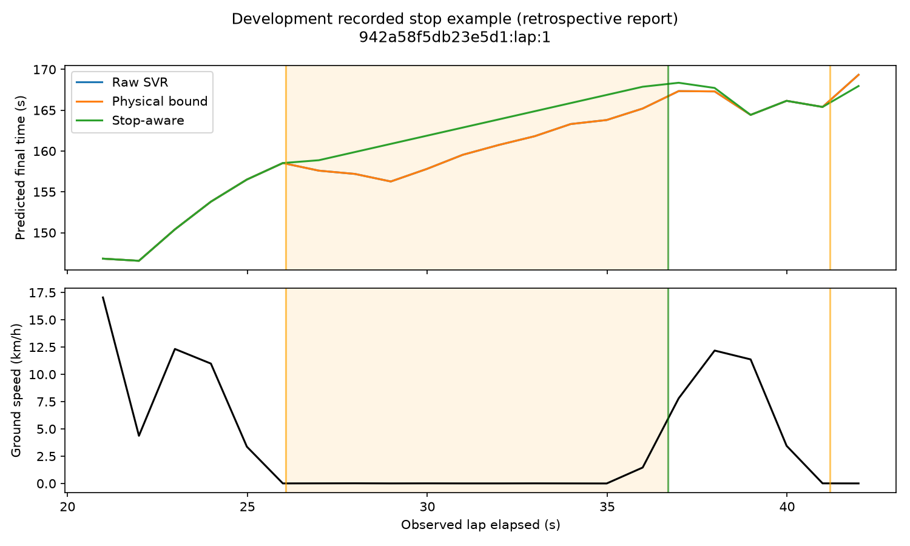

# Stop-aware prediction v0.8.1

All scores are exploratory development OOF on the original **169 laps / 40 recording blocks**, using the original five v072 folds. All **205 validated laps** remain preserved. **Zero new predictions on the 36 historical test laps** for selection. Reused development folds and uncertain physical recording links limit generalization; this is not a new independent final test. Operational model: original signed **SVR v0.7.1**, unchanged.

## Rule fixed before outcomes

Entry: valid ground speed ≤2 km/h continuously for at least 1 source second. Exit: ≥4 km/h continuously for 0.3 source seconds. Speeds between thresholds preserve an already confirmed stop. Pending entry/exit is labelled uncertain; the previous confirmed stationary assumption persists during exit confirmation. Invalid speed, timestamp reversal or gap >200 ms clears confirmation. Duplicate timestamps contribute zero elapsed duration. Slow driving above 2 km/h is not classified as a stop; sustained crawling below it can be, which is a limitation of speed-only detection.

On confirmation, reconstruct onset from already observed low-speed samples and query the unchanged model at that causal onset. Store `remaining_at_stop=max(0,raw_at_onset-onset)`. During the stop, emit `observed_elapsed+remaining_at_stop`. If onset is exactly zero, use the earliest already observed positive timestamp; if onset fails feature coverage, wait for the first valid causal model estimate. This heuristic freezes an uncertain estimate of remaining driving time, not true future remaining time.

Resume uses new SVR predictions immediately plus a nonnegative offset matching the preserved estimate at exit confirmation, decaying linearly over 2 observed seconds. This transition can still expose a jump if the new bound is higher; it is not an imposed maximum-jump promise. Predictions may fall after faster driving resumes. No displayed corrected estimate falls below elapsed time.

Raw, physically bounded and stop-aware outputs remain separate, including bound activation, adjustment size, stop onset and frozen remaining estimate. `max(raw,observed)` is a deterministic physical correction, not learned accuracy.

## Real recorded evidence

The fixed rule detects **30 episodes in 20 development laps** at every cadence. These are threshold-defined source observations, not independently adjudicated accident/stop labels. The other **149 laps** have no detected stop. The 1 s raw output has **242 impossible estimates**. MAE raw **8.787312**, bounded **8.708057**, stop-aware **8.708926 s** on identical observations. Bound and stop corrections are scored separately.

| model | population | laps | snapshots | mae_s | rmse_s | bias_s | p90_absolute_error_s | max_absolute_error_s |
| --- | --- | --- | --- | --- | --- | --- | --- | --- |
| A-BOUNDED | all | 169 | 21054 | 8.708057 | 16.099941 | -3.254443 | 21.473808 | 134.818332 |
| A-BOUNDED | no_detected_stop_laps | 149 | 17630 | 6.694266 | 11.681814 | -0.805887 | 15.457490 | 90.176114 |
| A-BOUNDED | detected_stop_laps | 20 | 3424 | 23.710798 | 34.258517 | -21.496186 | 60.084086 | 134.818332 |
| A-BOUNDED | stationary_observations | 18 | 67 | 24.430070 | 31.688660 | -15.916958 | 65.855160 | 71.649894 |
| A-RAW | all | 169 | 21054 | 8.787312 | 16.243565 | -3.333698 | 21.736421 | 134.818332 |
| A-RAW | no_detected_stop_laps | 149 | 17630 | 6.703162 | 11.690171 | -0.814783 | 15.462025 | 90.176114 |
| A-RAW | detected_stop_laps | 20 | 3424 | 24.314230 | 34.805797 | -22.099619 | 61.279947 | 134.818332 |
| A-RAW | stationary_observations | 18 | 67 | 24.457852 | 31.713999 | -15.944740 | 65.855160 | 71.649894 |
| A-STOP-AWARE | all | 169 | 21054 | 8.708926 | 16.100615 | -3.254381 | 21.458937 | 134.818332 |
| A-STOP-AWARE | no_detected_stop_laps | 149 | 17630 | 6.694266 | 11.681814 | -0.805887 | 15.457490 | 90.176114 |
| A-STOP-AWARE | detected_stop_laps | 20 | 3424 | 23.718142 | 34.261192 | -21.495658 | 60.318995 | 134.818332 |
| A-STOP-AWARE | stationary_observations | 18 | 67 | 24.442240 | 32.607095 | -17.028432 | 60.341358 | 77.702508 |
| B-1S-BOUNDED | all | 169 | 21054 | 8.465940 | 15.993371 | -3.608187 | 21.427908 | 133.120262 |
| B-1S-BOUNDED | no_detected_stop_laps | 149 | 17630 | 6.420268 | 11.511962 | -1.213593 | 14.804346 | 91.224581 |
| B-1S-BOUNDED | detected_stop_laps | 20 | 3424 | 23.706194 | 34.265065 | -21.447910 | 60.441485 | 133.120262 |
| B-1S-RAW | all | 169 | 21054 | 8.540758 | 16.129608 | -3.683004 | 21.654256 | 133.120262 |
| B-1S-RAW | no_detected_stop_laps | 149 | 17630 | 6.427761 | 11.518785 | -1.221086 | 14.814880 | 91.224581 |
| B-1S-RAW | detected_stop_laps | 20 | 3424 | 24.282579 | 34.783673 | -22.024295 | 61.346700 | 133.120262 |

Stop-aware minus bounded MAE on no-stop laps: **0.000000000000 s**. The stop correction is identically inactive on those laps. No favorable removal of slow laps or incidents is performed. Stationary-only scoring conditions on detected observations and reweights surviving laps; it must not be compared as if it were the full population.

## Behavioral verification and limits

Deterministic synthetic scenarios verify uninterrupted driving, braking, 3 km/h crawling, short low-speed noise, sustained stops, long stops, acceleration, multiple stops, invalid speed, source dropout, clock reversal and an extended >300 s lap. A constant 110 s model stopping at source second 10 predicts 111 at confirmed second 11 and 116 at second 16: exactly +5 s for +5 observed stationary seconds. Resume returns to the raw/bounded model after the documented 2 s transition. This is behavior verification, not measured real-stop predictive accuracy.

Stop onset remains uncertain during its first confirmation second. Frozen remaining time can be wrong when an incident changes future driving or the SVR was already biased. Telemetry gaps stop the replay; no elapsed stationary correction is accumulated across them. Replay pauses consume no source time. Real source export interpolation/latency are not independently certified.

